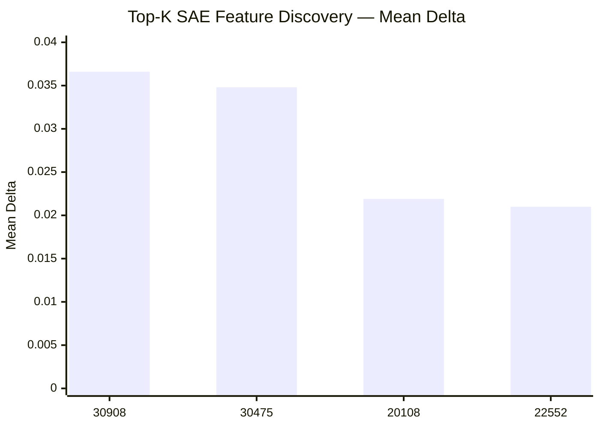
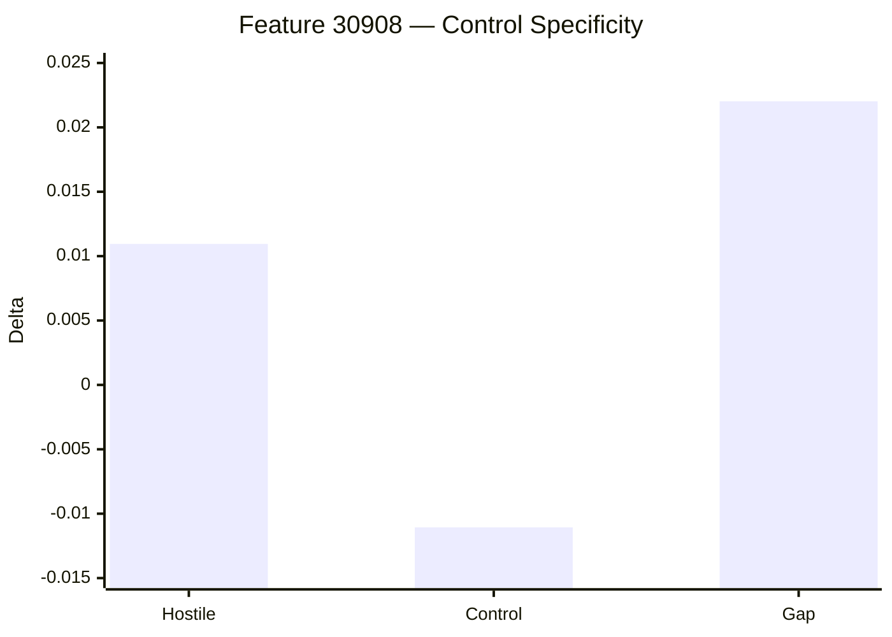

# MindScopeX 주간 연구 진행 현황 (2026-09-21 ~ 2026-09-30)

**연구 주제:** Qwen 기반 LLM의 CRT(Cognitive Reflection Test) 직관적 응답 분석 및 SAE Feature 인과 개입 효과 검증  
**연구 기간:** 2026년 9월 21일 ~ 9월 30일  
**핵심 연구:** GitHub·Codex·Google Colab 실험 환경 구축, Qwen3.5-2B-Base 기반 Top-K SAE Feature 탐색, Control Specificity 및 Behavioral Steering

## 1. 연구 목표

- GitHub → Codex → Google Colab A100 기반 개발·실험 환경 구축
- Qwen3.5-2B-Base 모델 Layer 5의 CRT 관련 SAE Feature 탐색
- Top-K 후보 Feature 개입 효과 측정
- Control Specificity 대조 실험을 통한 특이성 검증
- Behavioral Steering 실행 및 결과 Artifact 관리

## 2. 기간별 주요 진행 사항

| 날짜 | 진행 내용 | 주요 성과 |
|---|---|---|
| 09/23~09/24 | GitHub Fork 및 WSL 개발 환경 구성 | 프로젝트 코드 동기화 |
| 09/25~09/26 | Colab CLI 및 실험 파이프라인 검증 | Validation Artifact 확보 |
| 09/28 | 2B Full Study 실행 | A100 기반 실험 시작 |
| 09/29 | Colab CLI SSL 및 세션 문제 점검 | 인증서·세션 문제 분석 |
| 09/30 | Top-K SAE Feature Discovery | 27개 후보 분석(중간 결과) |
| 09/30 | Control Specificity | Feature 30908 대조 실험 완료 |
| 09/30 | Behavioral Steering | Feature 14817 및 Control Feature 12207 실행 |

## 3. 주요 실험 결과

### 3.1 Top-K SAE Feature Discovery (09/30)

- 모델: `Qwen3.5-2B-Base`
- 대상 Layer: `5`
- 후보 Feature: 27개
- Train 데이터: 24개 사례
- 실행 환경: Google Colab A100

| Feature | Mean Delta |
|---|---:|
| 30908 | +0.0366 |
| 30475 | +0.0348 |
| 20108 | +0.0219 |
| 22552 | +0.0210 |

**해석:** Feature 30908이 가장 높은 Mean Delta를 기록했으며 30475도 비슷한 값을 보였습니다. **주의:** 실행 세션이 중단되어 최종 Artifact가 완성되지 않았으므로, 위 수치는 당시 관찰된 **중간 결과**이며 공식 최종 Discovery 결과가 아닙니다.

### 3.2 Feature 30908 Control Specificity (09/30)

| 지표 | 결과 |
|---|---:|
| 분석 사례 | 54 |
| Hostile Delta | +0.01095 |
| Control Delta | -0.01106 |
| Specificity Gap | +0.02202 |

**해석:** Hostile 조건에서는 양의 변화, Control 조건에서는 음의 변화가 관찰되었고, 두 조건의 차이는 약 +0.02202였습니다. 통계적 유의성과 인과적 특이성의 최종 입증은 별도 검증이 필요합니다.

### 3.3 Behavioral Steering 실험 (09/30)

| 실험 | 대상 Feature | 목적 |
|---|---|---|
| `study_behavioral_topk_f14817_2b` | 14817 | 후보 Feature 개입 효과 확인 |
| `study_behavioral_control_nearzero_f12207_2b` | 12207 | 대조 Feature의 개입 효과 확인 |

두 실험 모두 Colab A100 환경에서 `research_experiments.py`를 실행한 기록이 확인됩니다. 이 기간의 최종 정답률과 Lure Rate 수치는 확인되지 않아 임의의 수치 그래프를 만들지 않았습니다.

## 4. 실험 환경 및 파이프라인 구축

- 09/23: `JeonDongJun/mindscopex_analysis`에서 `davidkss/mindscopex_analysis` Fork 기반 작업
- 09/24: WSL 저장소 동기화 및 개발 환경 점검; Python/`uv`/스모크 테스트 절차 확인
- 09/25: Colab CLI ADC 연결 및 Compute Units 조회 확인
- 09/26: `study_2b_validation` 실행 결과 Artifact 확보
- 09/28: Colab A100에서 2B Full Study 실행 시작
- 09/29: `REQUESTS_CA_BUNDLE=/etc/ssl/certs/ca-certificates.crt`로 SSL 인증서 경로 점검, 세션 조회 문제 확인
- 09/30: Top-K Discovery, Control Specificity, Behavioral Steering으로 실험 확대

## 5. 주요 성과

1. **실험 인프라 확보:** WSL·GitHub·Colab CLI·A100을 연계한 실행 체계 구축
2. **후보 Feature 탐색:** Layer 5에서 Feature 30908, 30475, 20108, 22552의 Mean Delta 중간값 관찰
3. **대조 실험 진행:** Feature 30908의 54개 사례 Control Specificity 결과 확보
4. **행동 검증 확대:** 후보 Feature 14817 및 대조 Feature 12207 실험 실행
5. **재현성 기반 마련:** TOML Suite, 실험 실행 스크립트 및 Artifact 관리 방식 검증

## 6. 미완료 사항 및 검증 과제

- 중단된 Top-K Discovery 재실행 및 최종 Artifact 확보
- Feature별 후보 순위의 Seed 간 재현성 검증
- Behavioral 실험 결과 정답률·Lure Rate 정량 분석
- Control Specificity의 통계적 유의성 및 신뢰구간 분석
- 2B Full Study 각 단계(Discovery → Strong Null → Control Specificity → Held-out → Behavioral)의 완료 여부 검증

## 7. 향후 연구 계획

1. Top-K Discovery 결과를 재현 가능한 형태로 확정
2. Feature 30908 등 주요 후보의 Multi-seed 검증 확대
3. Feature별 Steering 계수에 따른 Dose-response 분석
4. Behavioral, Held-out, Control 결과를 동일한 평가 체계로 비교
5. 논문용 실험 결과표 및 그래프 정리

## 8. 주간 보고용 핵심 요약

2026년 9월 21일부터 30일까지 MindScopeX 프로젝트에서는 GitHub·WSL·Google Colab A100 기반 실험 환경을 정비하고, Qwen3.5-2B-Base 모델의 Layer 5에서 CRT 관련 SAE Feature를 탐색하였습니다. 9월 30일 Top-K Discovery에서 27개 후보에 대한 분석을 수행하여 Feature 30908(+0.0366), 30475(+0.0348) 등의 Mean Delta 중간값을 관찰했으나, 세션 중단으로 최종 Artifact 확정은 필요합니다. Feature 30908에 대한 54개 사례 Control Specificity 실험에서는 Hostile Delta +0.01095, Control Delta -0.01106, Specificity Gap +0.02202가 확인되었습니다. 또한 Feature 14817 및 대조 Feature 12207의 Behavioral 실험을 실행하여 후속 재현성·인과 검증을 위한 기반을 마련했습니다.

> **기록 범위:** 이 문서는 2026-09-21~2026-09-30 기간에 확인되는 작업과 결과만을 반영했습니다. 10월 1일 이후의 Top-5 Multi-seed, Single/Pair/Triple, Dose-response 집계 결과는 포함하지 않았습니다.

---

## 후속 연구 해석 보완 (2026-10-23 작성) — 선택 문자 CASE 대조의 목적

> **시점 구분:** 아래 내용은 본 일지 기간에 실행한 실험 기록이 아니라, 2026-10-23에 수행·정리한 후속 Pilot 2B·3·4의 설계 이유와 결과를 연결하는 회고적 보완이다. 당시의 실행 결과 및 완료 상태는 위 원문을 따른다. 상세 수치·설정·한계는 [2026-10-23 연구 일지](2026-10-23.md)를 참조한다.

**핵심 연구 질문:** Layer 5 SAE Feature 22552의 개입 후 CRT 정답률이 달라지는 현상이 실제 정답의 의미를 선택한 결과인지, 아니면 출력 문자 또는 선택지 제시 위치에 대한 편향인지 구별할 수 있는가?

| 후속 CASE | 문자 배치 | 실험한 이유 |
|---|---|---|
| Pilot 2B | A/B | 기준 문자 조합에서 계수별 응답 문자 분포와 정답률을 함께 확인하고, B 고정 선택이 정답률을 설명하는지 탐색 |
| Pilot 3 | X/Y | 문자 집합을 바꾸어 A/B 고유의 표면 형식에 의존하는 효과인지 탐색 |
| Pilot 4A | B/A | A/B의 문자 순서를 반전하여 B의 위치가 바뀌었을 때 응답이 어떻게 달라지는지 확인 |
| Pilot 4B | Y/X | X/Y의 문자 순서를 반전하여 X·Y 문자 정체성과 제시 위치의 영향을 추가 점검 |

각 CASE에서 `correct_first`(첫 번째 설정 문자에 정답)와 `lure_first`(두 번째 설정 문자에 정답)를 교차 평가한다. 동일한 CRT 정답값·lure값을 유지하고 문자·배치만 바꾸므로, 특정 문자를 무조건 고르는 모델은 정답 배치에 따라 정확도가 달라질 수 있다. **20개 사례 × 정답 배치 2종 = 40개 평가 조건**은 독립 문항 40개를 뜻하지 않는다.

**후속 관찰:** Pilot 2B에서는 -7 및 +4에서 B 선택 100%·전체 정답률 50%, Pilot 3의 +4에서는 X 선택 87.5%·정답률 57.5%였다. Pilot 4A(B/A)와 4B(Y/X)는 Baseline부터 각각 첫 문자 B·Y를 100% 선택하여 개입 전후 차이를 확인하기 어려웠다(포화). 이 결과만으로 문자 정체성, 위치 또는 CRT 의미 추론 변화 중 어느 요인이 원인인지 확정할 수 없다.

**연구 해석 원칙:** 과거 실험에서 보고된 정답률 개선은 해당 실험 프로토콜의 관찰값으로 보존하되, 의미적 추론 능력 개선의 확정 증거로 해석하지 않는다. 후속 Pilot 5에서는 포화되지 않은 Baseline, 문자·위치 교차 통제, 무개입 계수 0, 다중 seed, 가능하다면 출력 로그잇 및 대조 Feature를 추가 검증한다.
