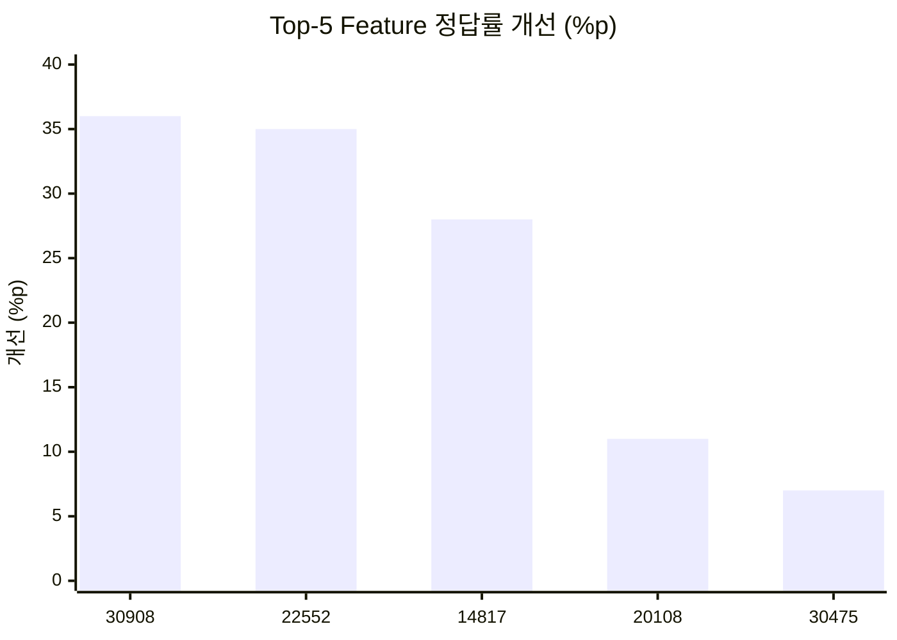
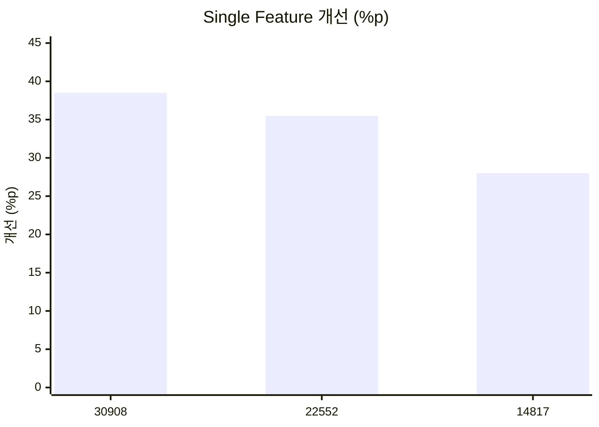
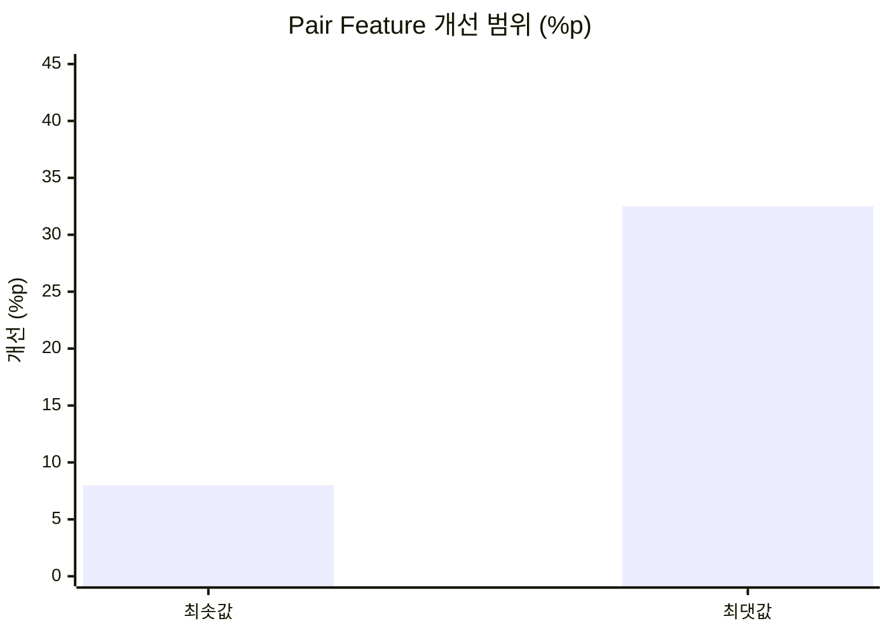
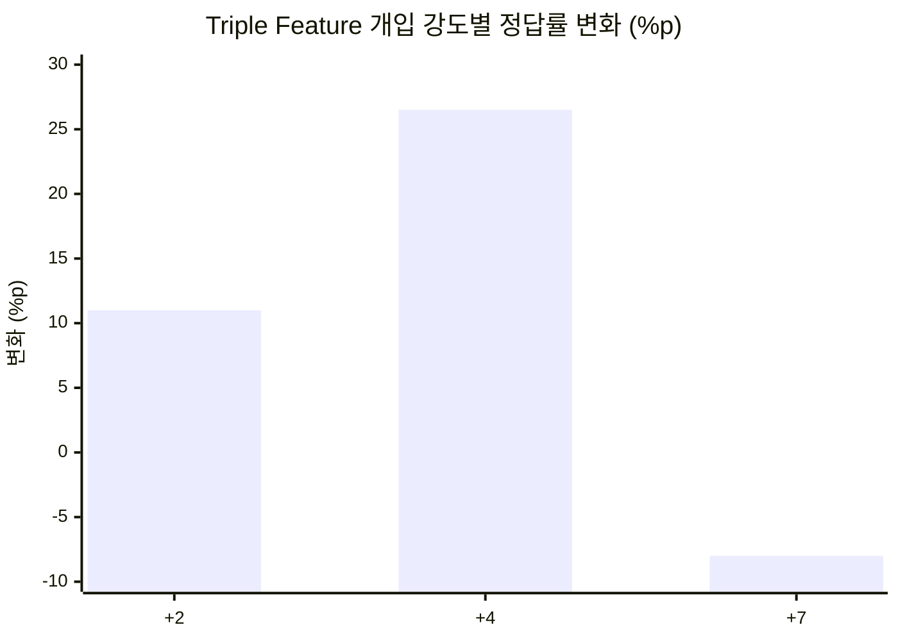
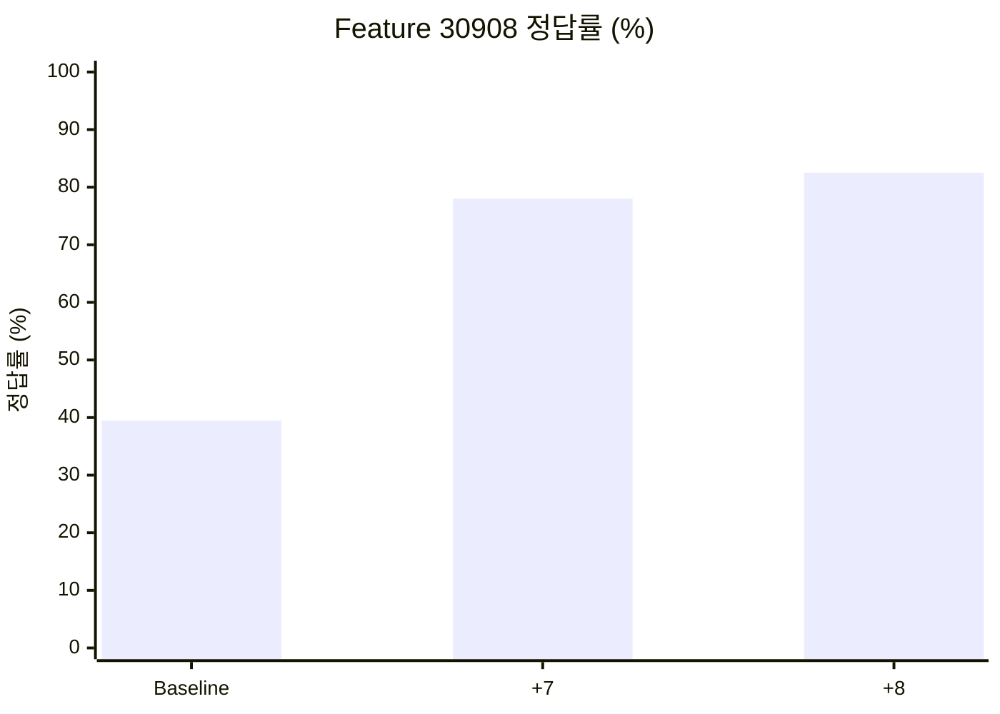

# MindScopeX 주간 연구 진행 현황 (2026-10-01 ~ 2026-10-10)

**연구 주제:** Qwen 기반 LLM의 CRT 직관적 응답 분석 및 SAE Feature 인과 개입 효과 검증  
**연구 기간:** 2026년 10월 1일 ~ 10월 10일

## 1. 연구 목표

- Top-5 SAE Feature의 Multi-seed 개입 효과 재현성 검증
- Single/Pair/Triple Feature 개입에 따른 CRT 정답률 비교
- Coefficient Dose-response 및 Feature 간 상호작용 분석
- Colab A100 기반 반복 실험 자동화 및 결과 관리

## 2. 금주 진행 사항

### 2.1 Top-5 SAE Feature Multi-seed 검증 (10/01~10/02)

Coefficient `+7`, 5 Features × 5 Seeds = 25개 실험.

**실험 용어 설명**

- **Multi-seed(다중 시드):** 난수 생성의 초기 상태를 정하는 `seed`를 여러 값으로 바꾸어 같은 실험 조건을 반복하고, 관찰 결과가 특정 시드에만 의존하는지 확인하는 방법이다. 시드는 데이터셋 자체나 모델의 Layer 번호가 아니다.
- **5 Seeds의 의미:** 서로 다른 시드 설정 **5개**로 각 Feature의 개입 효과를 평가한다는 뜻이다. 예를 들어 Feature 30908에 대해 다섯 시드 조건을 실행하고, 이를 나머지 네 Feature에도 적용하면 **5 Features × 5 Seeds = 25개 Feature–Seed 실행 조건**이 된다. 이는 서로 독립적인 CRT 문항 25개를 의미하지 않는다.
- **Coefficient(개입 계수):** 선택한 SAE Feature를 이용한 Steering 개입의 강도와 부호를 설정하는 값이다. `+7`은 해당 실험 구현에서 양(+)의 방향으로 크기 7의 개입을 적용하도록 지정한 설정이다. `-7`은 반대 부호의 설정, `0`은 계수 0 조건이다. **양수라고 정답률이 반드시 상승하는 것은 아니다.** 실제 활성화 변화의 수학적 방식과 무개입 동등성은 구현 코드를 기준으로 확인해야 한다.

> **재현성 해석 주의:** 서로 다른 seed를 사용했다고 반드시 출력이 달라지는 것은 아니다. 특히 결정론적 디코딩에서는 시드 변경의 영향이 제한될 수 있으며, 5개 실행 결과를 독립 문항 5개로 간주하지 않는다.

| SAE Feature | 평균 정답률 개선 |
|---|---:|
| 30908 | +36.0%p |
| 22552 | +35.0%p |
| 14817 | +28.0%p |
| 20108 | +11.0%p |
| 30475 | +7.0%p |

상위 세 Feature(30908, 22552, 14817)를 후속 분석 대상으로 선정했습니다.

### 2.2 Single/Pair/Triple 개입 (10/03)

**Single Feature 결과**

| Feature | 정답률 개선 |
|---|---:|
| 30908 | +38.5%p |
| 22552 | +35.5%p |
| 14817 | +28.0%p |

**Pair Feature 결과**

조합에 따라 **+8.0~+32.5%p** 개선이 관찰되었습니다.

| 구분 | 정답률 개선 |
|---|---:|
| 관찰된 최솟값 | +8.0%p |
| 관찰된 최댓값 | +32.5%p |

> **그래프 범위:** 위 두 막대는 개별 Pair 조합의 결과가 아니라 기록에 남아 있는 개선 폭의 최솟값과 최댓값입니다. 조합별 수치는 원본 Artifact 확인 후 보완해야 합니다.

**Triple Feature 결과**

| Coefficient | 정답률 변화 |
|---|---:|
| +2 | +11.0%p |
| +4 | +26.5%p |
| +7 | -8.0%p |

높은 개입 강도에서 성능이 저하되는 비선형 반응을 관찰했습니다.

### 2.3 Coefficient Dose-response (10/03~10/04)

**Dose-response(개입 강도–반응 관계) 정의:** SAE Feature에 적용하는 Coefficient를 여러 값으로 바꾸면서 모델의 정답률, Lure 선택률 등 행동 지표가 어떻게 변하는지 측정하는 분석이다. 여기서 **Dose는 약물 투여량이 아니라 Feature 개입 계수의 크기·부호**, **Response는 모델 응답 지표의 변화**를 의미한다.

예를 들어 동일한 Feature에 `-8 → -4 → 0 → +4 → +8`을 적용하여 정답률 변화를 비교한다. 계수 증가에 비례해 결과가 좋아진다고 가정하지 않으며, 비선형 변화나 성능 악화도 연구 결과로 기록한다.

- 대상: Feature 30908, 22552, 14817
- 계수: `-8, -4, -2, 0, +2, +4, +7, +8`
- 설계: 3 Features × 5 Seeds × 8 Coefficients = 120개 조건
- Zero-control (`0`) 확인

**Feature 30908 주요 결과**

| 조건 | 정답률 | Baseline 대비 |
|---|---:|---:|
| Baseline | 39.5% | — |
| +7 | 78.0% | +38.5%p |
| +8 | 82.5% | +43.0%p |

그래프는 확인된 세 조건만 보여주며 전체 Dose-response 곡선은 아닙니다.

### 2.4 Colab 및 GitHub 실험 관리

- Google Colab A100 GPU에서 실험 실행
- TOML 기반 Suite와 `research_experiments.py`를 통한 반복 실행
- 결과 Artifact 저장 및 분석 데이터 관리
- Single/Pair/Triple 분석 코드 및 설정 파일 반영 (커밋 `60615f6`)
- Behavioral Dose/Resume Suite 설정 파일 추가 (10/06, 커밋 `41a9481`)

## 3. 주요 연구 성과

1. Top-5 Feature의 반복 실험에서 개선 폭 비교 및 Top-3 선정
2. Single/Pair/Triple 개입 간 성능 차이와 비선형 반응 관찰
3. Feature 30908의 +8 조건에서 82.5% 정답률 및 +43.0%p 개선 관찰
4. TOML Suite, Colab A100, GitHub 기반 실험 실행·관리 체계 강화

## 4. 미완료 사항 및 검증 과제

- Seed별 분산·신뢰구간 및 통계적 유의성 검증
- 다중 Feature의 성능 저하 원인 분석
- CRT 유형별(Difference, Rate, Growth) 결과 비교

**CRT 유형 정의 — 세 가지 문제군**

| 유형 | 의미 | 대표적인 문제 구조 | 주요 함정(Lure) |
|---|---|---|---|
| **Difference(차이)** | 두 수량의 **합계와 차이**를 함께 제시하고 특정 값을 구하는 문제 | 두 물건의 합계가 39달러이고 하나가 다른 것보다 27달러 비싸다면 싼 물건의 가격은? (정답 6달러) | 합계에서 차이만 빼고 12달러라고 답하는 직관적 오류 |
| **Rate(속도·작업률)** | 여러 대상이 동시에 일할 때의 **개별 작업률과 전체 소요 시간**을 구하는 문제 | 여러 기계가 동시에 작업할 때 전체 완료 시간을 계산 | 작업자 수와 시간을 단순 비례시키거나 병렬 작업률을 잘못 계산 |
| **Growth(증가·성장)** | **반복적인 배가 또는 지수적 증가**가 특정 상태에 도달하는 시점을 구하는 문제 | 매 기간 두 배로 증가하는 양이 특정 시점에 가득 찬다면 절반은 언제인가? | 지수적 성장 대신 선형 증가처럼 생각 |

> **분석 목적:** Feature 개입 효과를 전체 평균만으로 판단하지 않고 세 유형별로 나누어 확인한다. 특정 유형에서는 정답률이 상승하고 다른 유형에서는 하락할 수 있기 때문이다. 위 예시는 개념 설명이며 각 평가 문항의 실제 정답·Lure는 데이터셋 원본으로 확인한다.
- 다른 문제·응답 형식에서의 강건성 검증
- 120개 실험 조건의 결과 완전성 점검

## 5. 향후 연구 계획

1. Top-3 Feature의 Multi-seed Dose-response 통합 분석
2. Feature별 최적 Coefficient 비교
3. Single/Pair/Triple 상호작용 분석
4. Negative Dose 및 대조 실험 강화
5. 논문용 표와 시각화 자료 정리

## 6. 주간 보고용 핵심 요약

이번 주에는 Qwen 모델의 주요 SAE Feature를 대상으로 Multi-seed 강건성 검증과 Single/Pair/Triple 인과 개입 및 Dose-response 실험을 진행했습니다. Top-5 반복 실험을 통해 Feature 30908, 22552, 14817을 핵심 분석 대상으로 선정했습니다. Feature 30908에 Coefficient +8을 적용했을 때 평균 CRT 정답률은 39.5%에서 82.5%로 개선되었습니다. 다중 Feature 개입에서는 높은 계수에서 오히려 성능이 저하되는 비선형 반응도 관찰했습니다. 후속 연구에서는 통계 검증, 강건성 검증 및 Feature 상호작용 분석을 강화할 계획입니다.

> **해석 유의사항:** 본 문서의 수치는 기존 연구 기록에 기재된 관찰 결과입니다. 원본 Artifact를 이번 정리에서 재계산한 것은 아니며, 통계적 유의성이나 인과적 일반화가 최종 입증된 것은 아닙니다.

---

## 후속 연구 해석 보완 (2026-10-23 작성) — 선택 문자 CASE 대조의 목적

> **시점 구분:** 아래 내용은 본 일지 기간에 실행한 실험 기록이 아니라, 2026-10-23에 수행·정리한 후속 Pilot 2B·3·4의 설계 이유와 결과를 연결하는 회고적 보완이다. 당시의 실행 결과 및 완료 상태는 위 원문을 따른다. 상세 수치·설정·한계는 [2026-10-23 연구 일지](2026-10-23.md)를 참조한다.

**핵심 연구 질문:** Layer 5 SAE Feature 22552의 개입 후 CRT 정답률이 달라지는 현상이 실제 정답의 의미를 선택한 결과인지, 아니면 출력 문자 또는 선택지 제시 위치에 대한 편향인지 구별할 수 있는가?

| 후속 CASE | 문자 배치 | 실험한 이유 |
|---|---|---|
| Pilot 2B | A/B | 기준 문자 조합에서 계수별 응답 문자 분포와 정답률을 함께 확인하고, B 고정 선택이 정답률을 설명하는지 탐색 |
| Pilot 3 | X/Y | 문자 집합을 바꾸어 A/B 고유의 표면 형식에 의존하는 효과인지 탐색 |
| Pilot 4A | B/A | A/B의 문자 순서를 반전하여 B의 위치가 바뀌었을 때 응답이 어떻게 달라지는지 확인 |
| Pilot 4B | Y/X | X/Y의 문자 순서를 반전하여 X·Y 문자 정체성과 제시 위치의 영향을 추가 점검 |

각 CASE에서 `correct_first`(첫 번째 설정 문자에 정답)와 `lure_first`(두 번째 설정 문자에 정답)를 교차 평가한다. 동일한 CRT 정답값·lure값을 유지하고 문자·배치만 바꾸므로, 특정 문자를 무조건 고르는 모델은 정답 배치에 따라 정확도가 달라질 수 있다. **20개 사례 × 정답 배치 2종 = 40개 평가 조건**은 독립 문항 40개를 뜻하지 않는다.

**후속 관찰:** Pilot 2B에서는 -7 및 +4에서 B 선택 100%·전체 정답률 50%, Pilot 3의 +4에서는 X 선택 87.5%·정답률 57.5%였다. Pilot 4A(B/A)와 4B(Y/X)는 Baseline부터 각각 첫 문자 B·Y를 100% 선택하여 개입 전후 차이를 확인하기 어려웠다(포화). 이 결과만으로 문자 정체성, 위치 또는 CRT 의미 추론 변화 중 어느 요인이 원인인지 확정할 수 없다.

**연구 해석 원칙:** 과거 실험에서 보고된 정답률 개선은 해당 실험 프로토콜의 관찰값으로 보존하되, 의미적 추론 능력 개선의 확정 증거로 해석하지 않는다. 후속 Pilot 5에서는 포화되지 않은 Baseline, 문자·위치 교차 통제, 무개입 계수 0, 다중 seed, 가능하다면 출력 로그잇 및 대조 Feature를 추가 검증한다.
