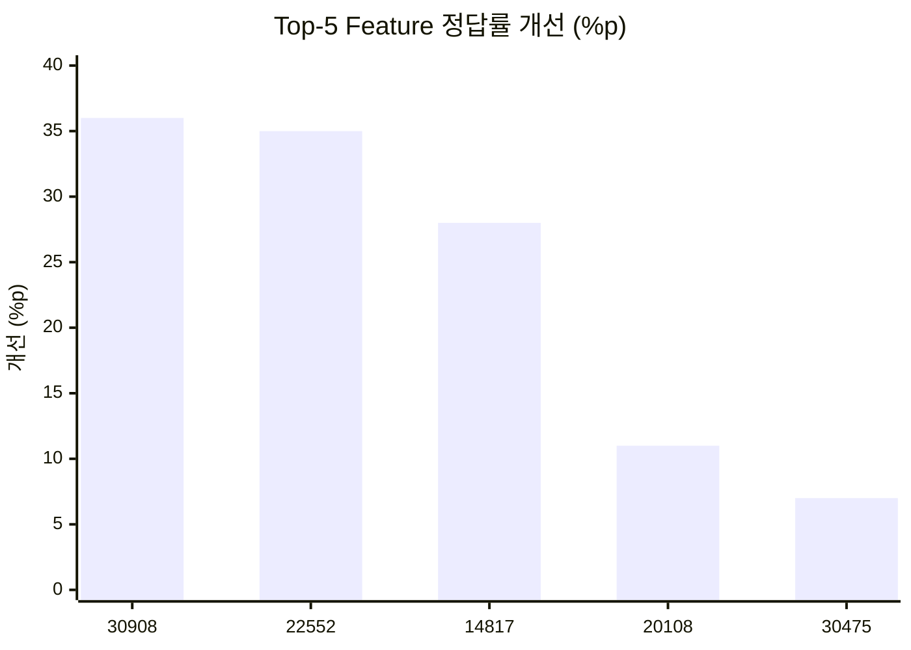
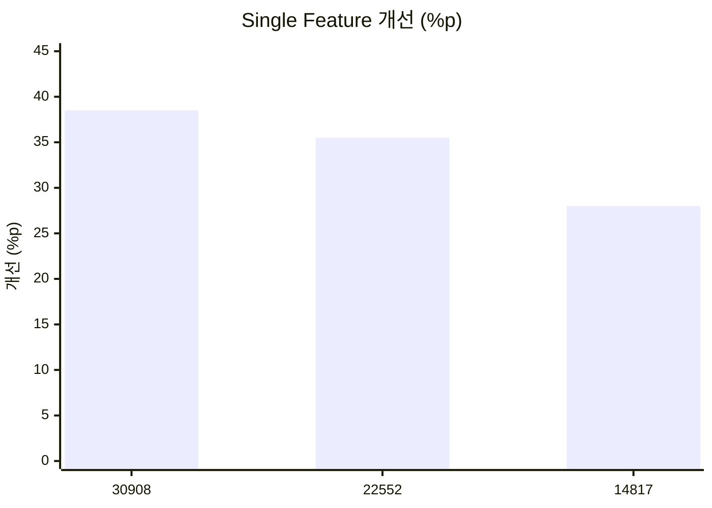
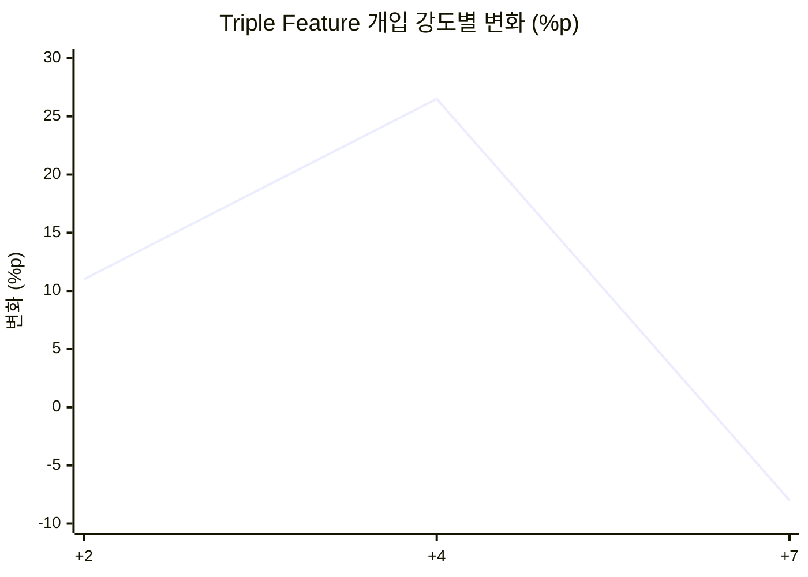
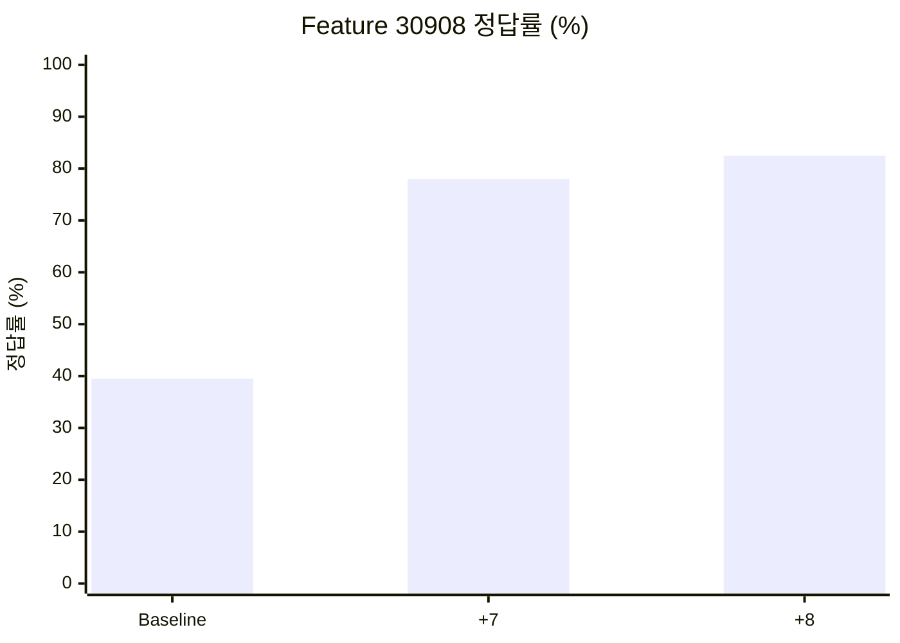

# MindScopeX 주간 연구 진행 현황 (2026-10-01 ~ 2026-10-10)

**연구 주제:** Qwen 기반 LLM의 CRT 직관적 응답 분석 및 SAE Feature 인과 개입 효과 검증  
**연구 기간:** 2026년 10월 1일 ~ 10월 10일

## 1. 연구 목표

- Top-5 SAE Feature의 Multi-seed 개입 효과 재현성 검증
- Single/Pair/Triple Feature 개입에 따른 CRT 정답률 비교
- Coefficient Dose-response 및 Feature 간 상호작용 분석
- Colab A100 기반 반복 실험 자동화 및 결과 관리

## 2. 금주 진행 사항

### 2.1 Top-5 SAE Feature Multi-seed 검증 (10/01~10/02)

Coefficient `+7`, 5 Features × 5 Seeds = 25개 실험.

| SAE Feature | 평균 정답률 개선 |
|---|---:|
| 30908 | +36.0%p |
| 22552 | +35.0%p |
| 14817 | +28.0%p |
| 20108 | +11.0%p |
| 30475 | +7.0%p |

상위 세 Feature(30908, 22552, 14817)를 후속 분석 대상으로 선정했습니다.

### 2.2 Single/Pair/Triple 개입 (10/03)

**Single Feature 결과**

| Feature | 정답률 개선 |
|---|---:|
| 30908 | +38.5%p |
| 22552 | +35.5%p |
| 14817 | +28.0%p |

**Pair Feature:** 조합에 따라 +8.0~32.5%p 개선이 관찰되었습니다.

**Triple Feature 결과**

| Coefficient | 정답률 변화 |
|---|---:|
| +2 | +11.0%p |
| +4 | +26.5%p |
| +7 | -8.0%p |

높은 개입 강도에서 성능이 저하되는 비선형 반응을 관찰했습니다.

### 2.3 Coefficient Dose-response (10/03~10/04)

- 대상: Feature 30908, 22552, 14817
- 계수: `-8, -4, -2, 0, +2, +4, +7, +8`
- 설계: 3 Features × 5 Seeds × 8 Coefficients = 120개 조건
- Zero-control (`0`) 확인

**Feature 30908 주요 결과**

| 조건 | 정답률 | Baseline 대비 |
|---|---:|---:|
| Baseline | 39.5% | — |
| +7 | 78.0% | +38.5%p |
| +8 | 82.5% | +43.0%p |

그래프는 확인된 세 조건만 보여주며 전체 Dose-response 곡선은 아닙니다.

### 2.4 Colab 및 GitHub 실험 관리

- Google Colab A100 GPU에서 실험 실행
- TOML 기반 Suite와 `research_experiments.py`를 통한 반복 실행
- 결과 Artifact 저장 및 분석 데이터 관리
- Single/Pair/Triple 분석 코드 및 설정 파일 반영 (커밋 `60615f6`)
- Behavioral Dose/Resume Suite 설정 파일 추가 (10/06, 커밋 `41a9481`)

## 3. 주요 연구 성과

1. Top-5 Feature의 반복 실험에서 개선 폭 비교 및 Top-3 선정
2. Single/Pair/Triple 개입 간 성능 차이와 비선형 반응 관찰
3. Feature 30908의 +8 조건에서 82.5% 정답률 및 +43.0%p 개선 관찰
4. TOML Suite, Colab A100, GitHub 기반 실험 실행·관리 체계 강화

## 4. 미완료 사항 및 검증 과제

- Seed별 분산·신뢰구간 및 통계적 유의성 검증
- 다중 Feature의 성능 저하 원인 분석
- CRT 유형별(Difference, Rate, Growth) 결과 비교
- 다른 문제·응답 형식에서의 강건성 검증
- 120개 실험 조건의 결과 완전성 점검

## 5. 향후 연구 계획

1. Top-3 Feature의 Multi-seed Dose-response 통합 분석
2. Feature별 최적 Coefficient 비교
3. Single/Pair/Triple 상호작용 분석
4. Negative Dose 및 대조 실험 강화
5. 논문용 표와 시각화 자료 정리

## 6. 주간 보고용 핵심 요약

이번 주에는 Qwen 모델의 주요 SAE Feature를 대상으로 Multi-seed 강건성 검증과 Single/Pair/Triple 인과 개입 및 Dose-response 실험을 진행했습니다. Top-5 반복 실험을 통해 Feature 30908, 22552, 14817을 핵심 분석 대상으로 선정했습니다. Feature 30908에 Coefficient +8을 적용했을 때 평균 CRT 정답률은 39.5%에서 82.5%로 개선되었습니다. 다중 Feature 개입에서는 높은 계수에서 오히려 성능이 저하되는 비선형 반응도 관찰했습니다. 후속 연구에서는 통계 검증, 강건성 검증 및 Feature 상호작용 분석을 강화할 계획입니다.

> **해석 유의사항:** 본 문서의 수치는 기존 연구 기록에 기재된 관찰 결과입니다. 원본 Artifact를 이번 정리에서 재계산한 것은 아니며, 통계적 유의성이나 인과적 일반화가 최종 입증된 것은 아닙니다.
