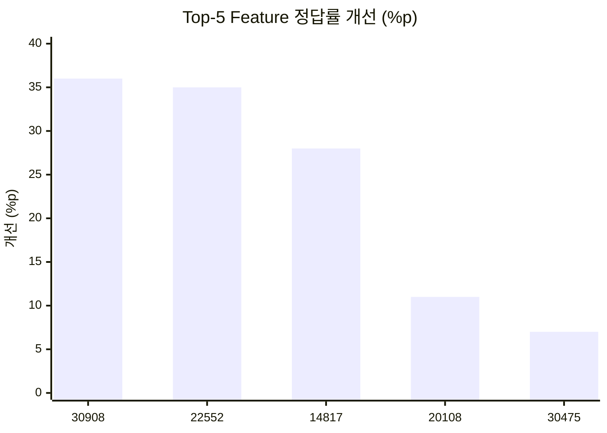
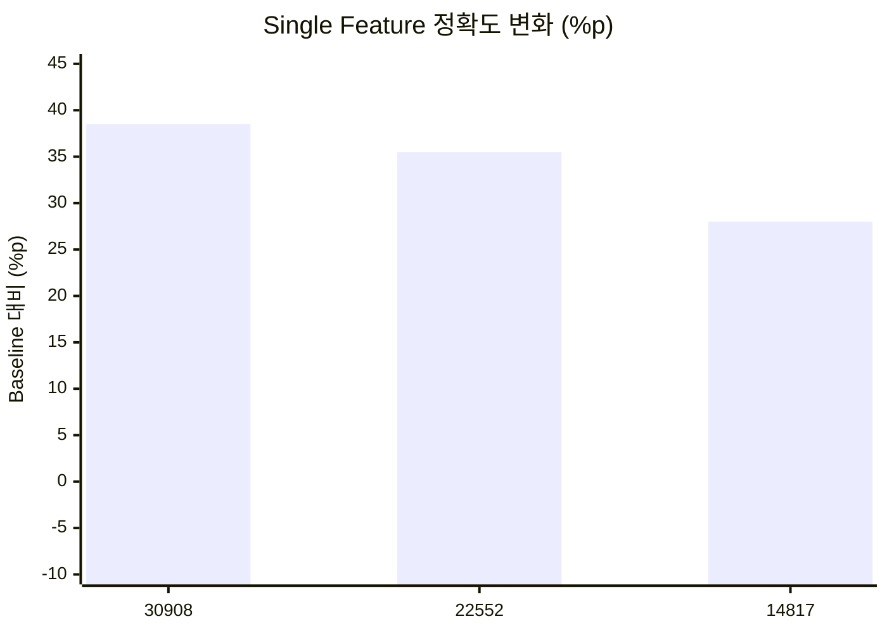
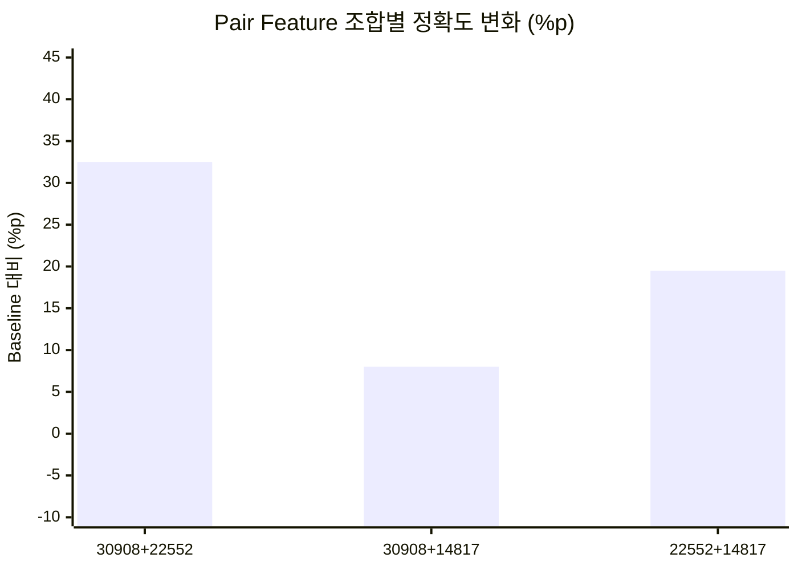
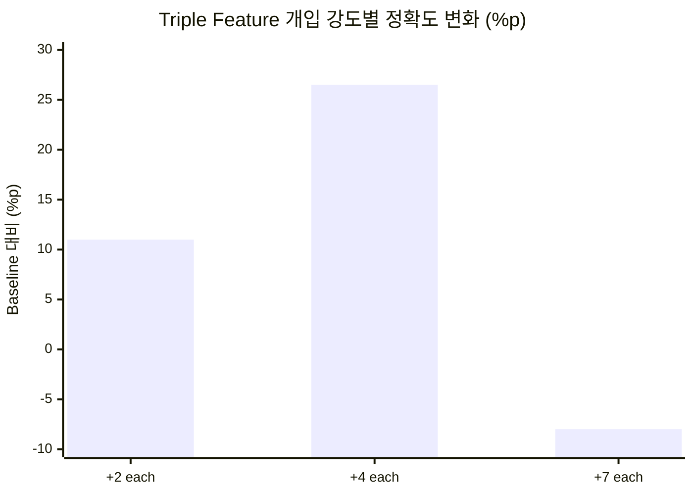
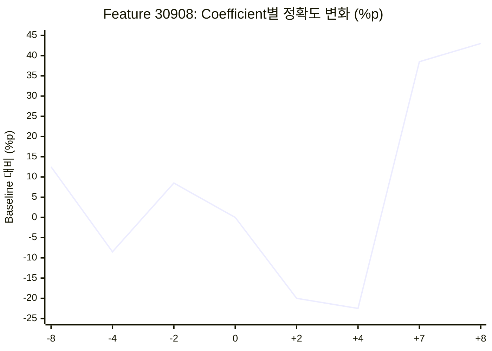

# MindScopeX 주간 연구 진행 현황 (2026-10-01 ~ 2026-10-10)

**연구 주제:** Qwen 기반 LLM의 CRT 직관적 응답 분석 및 SAE Feature 인과 개입 효과 검증  
**연구 기간:** 2026년 10월 1일 ~ 10월 10일

## 1. 연구 목표

- Top-5 SAE Feature의 Multi-seed 개입 효과 재현성 검증
- Single/Pair/Triple Feature 개입에 따른 CRT 정답률 비교
- Coefficient Dose-response 및 Feature 간 상호작용 분석
- Colab A100 기반 반복 실험 자동화 및 결과 관리

## 2. 금주 진행 사항

### 2.1 Top-5 SAE Feature Multi-seed 검증 (10/01~10/02)

**실험 환경:** `Qwen/Qwen3.5-2B-Base` · Hagendorff CRT · Layer 5 · 정답(Correct)/유인답(Lure) 기반 정확도 평가. 개별 Split Seed는 40개 평가 Case로 구성되었습니다.\n\nCoefficient `+7`, 5 Features × 5 Split Seeds = 25개 Feature–Split 조합 평가 조건.

**실험 용어 설명**

- **Seed(시드):** 일반적으로 난수 생성기의 초기값을 의미한다. 하지만 **이번 실험에서 사용하는 `Split Seed 0, 1, 2, 3, 4`는 주로 CRT 평가 문제를 선택·구성하는 데이터 분할 시드**이다. 같은 Feature와 개입 강도를 다른 평가 Case 구성에서 비교하는 데 사용한다.
- **Split Seed와 Generation Seed의 차이:** Split Seed는 **어떤 CRT 문항을 평가할지**에 관여하고, Generation Seed는 **모델의 확률적 답변 생성**에 관여할 수 있다. 둘은 구분해야 한다. 동일 Split Seed는 동일한 데이터 생성 코드와 설정 아래 평가 Case 구성을 재현하기 위한 설정이다.
- **Multi-seed(다중 시드):** 여기서는 **여러 Split Seed(0~4)의 서로 다른 CRT 평가 구성에서 같은 Feature 개입을 반복 비교**하는 검증 방법이다. 독립적인 모델 5개를 뜻하지 않는다.
- **5 Seeds의 의미:** 각 Feature를 Split Seed 0·1·2·3·4의 **다섯 평가 구성**에 적용하는 것이다. 예: Feature 30908 × 5 Split Seeds = 5개 평가 조건; 5 Features × 5 Split Seeds = **25개 Feature–Split 조건**. **각 Split Seed에 40개 평가 Case**가 포함되므로, 25개의 독립 CRT 문제만 평가했다는 의미는 아니다.
- **Steering 개입(Activation Steering):** 모델이 응답을 생성하는 동안 **특정 Layer의 내부 활성화(Residual Stream 등)에 의도적인 변화를 가해**, 그 변화가 최종 답변에 어떤 영향을 주는지 확인하는 실험 방법이다. MindScopeX에서는 Qwen3.5-2B 계열의 **Layer 5**에서 SAE로 분석한 Feature(예: `30908`, `22552`, `14817`)를 개입 대상으로 선정하고, **Coefficient**를 바꿔 CRT 정답(Correct)·직관적 오답(Lure) 선택 및 정답률 변화를 비교한다. **Baseline**은 개입 전 비교 조건, **Intervention**은 Steering을 적용한 조건이다. 예를 들어 Feature `30908`에 Coefficient `+7`과 `+8`을 각각 적용한 결과를 Baseline과 비교할 수 있다. Steering은 모델 가중치를 다시 학습하는 **Fine-tuning과 달리 추론 중 내부 표현을 조정**하는 방식이다. 다만 정답률 변화만으로 해당 Feature가 '추론을 담당한다'거나 실제 추론 능력이 개선되었다고 단정할 수는 없다. 구체적인 활성화 수정 수식·토큰 위치·적용 범위는 실행 코드와 설정을 확인해야 한다.
- **Coefficient(개입 계수):** 선택한 SAE Feature를 이용한 Steering 개입의 강도와 부호를 설정하는 값이다. `+7`은 해당 실험 구현에서 양(+)의 방향으로 크기 7의 개입을 적용하도록 지정한 설정이다. `-7`은 반대 부호의 설정, `0`은 계수 0 조건이다. **양수라고 정답률이 반드시 상승하는 것은 아니다.** 실제 활성화 변화의 수학적 방식과 무개입 동등성은 구현 코드를 기준으로 확인해야 한다.

> **해석 주의:** 본 실험의 Split Seed에 따른 차이는 우선 **평가 문제 구성 차이**로 이해해야 한다. 이를 모델 생성 시 난수만 바꾼 실험으로 해석하지 않는다. Seed별 평가 세트가 서로 완전히 독립인지, 사례가 중복되는지는 데이터 및 split 생성 코드를 확인해야 한다.

| SAE Feature | 평균 정답률 개선 |
|---|---:|
| 30908 | +36.0%p |
| 22552 | +35.0%p |
| 14817 | +28.0%p |
| 20108 | +11.0%p |
| 30475 | +7.0%p |

상위 세 Feature(30908, 22552, 14817)를 후속 분석 대상으로 선정했습니다.

### 2.2 Top-3 Single/Pair/Triple 개입 (10/03)

**연구 질문:** 개별 Feature가 개선 효과를 보였다면, 여러 Feature를 동시에 Steering할 때 그 효과가 단순히 더해지는가? 비교 대상은 Layer 5의 Feature `30908`, `22552`, `14817`이며, 아래 Single/Pair/Triple 비교는 **각 Feature당 Coefficient +7**, 다섯 Split Seed 평균을 기준으로 한다. 정답률 변화는 Baseline 대비 백분율포인트(%p)이다.

**Single Feature (+7)**

| Feature | 정답률 변화 |
|---|---:|
| 30908 | +38.5%p |
| 22552 | +35.5%p |
| 14817 | +28.0%p |

**Pair Feature (+7 each)**

| Feature 조합 | 정답률 변화 |
|---|---:|
| 30908 + 22552 | +32.5%p |
| 30908 + 14817 | +8.0%p |
| 22552 + 14817 | +19.5%p |

단독 개입의 성과가 높아도 두 Feature를 함께 사용한 결과가 더 좋지는 않았다. 예를 들어 30908 단독 +38.5%p에 비해 30908+14817 조합은 +8.0%p였다.

**Triple Feature (30908 + 22552 + 14817, 각 Feature당 같은 Coefficient)**

| Coefficient per Feature | Baseline | Steering 후 | 정답률 변화 |
|---|---:|---:|---:|
| +2 each | 39.5% | 50.5% | +11.0%p |
| +4 each | 39.5% | 66.0% | +26.5%p |
| +7 each | 39.5% | 31.5% | -8.0%p |

**Figure 2A (Single vs Pair vs Triple at +7) 해석:** Single 세 조건 모두 개선되었지만 Pair의 개선 폭은 조합에 따라 달랐고 Triple(+7 each)은 -8.0%p로 악화되었다. 따라서 **Feature들의 행동 효과는 단순한 산술 합과 일치하지 않았다(관찰된 비가산성, non-additivity)**. 단, 특정 Feature들이 서로를 억제하는 기전이라고 확정할 수는 없다.

**Figure 2B (Triple intervention strength) 해석:** Triple 조합을 유지하고 각 Feature의 계수만 +2 → +4 → +7로 변경한 결과, +4에서 가장 큰 전체 개선이 관찰되었지만 +7에서는 성능이 악화되었다. 이는 **측정한 강도 범위에서의 비선형 반응**이다. +4가 일반적인 최적 계수라는 주장은 아니다.

**Triple 실험의 CRT 유형별 결과 (각 계수에서 Baseline 대비 %p)**

| Coefficient per Feature | Difference | Rate | Growth | Overall |
|---|---:|---:|---:|---:|
| +2 | +6.75 | -8.68 | +34.36 | +11.0 |
| +4 | +30.39 | +16.81 | +31.08 | +26.5 |
| +7 | -12.99 | -48.35 | +35.90 | -8.0 |

동일한 Triple +7 개입에서도 Growth는 +35.90%p, Rate는 -48.35%p, Difference는 -12.99%p였다. 따라서 전체 평균은 **서로 반대 방향으로 움직이는 문제군별 변화를 가릴 수 있다**. Figure 2의 Error bar는 다섯 Split Seed 결과의 **표본 표준편차(SD)**를 나타내며, 통계적 유의성 또는 신뢰구간 자체를 의미하지 않는다.

### 2.3 Coefficient Dose-response (10/03~10/04)

**Dose-response(개입 강도–반응 관계):** 동일 SAE Feature에 적용하는 Steering Coefficient의 값과 부호를 변경하고, 모델의 CRT 응답 정확도가 어떻게 달라지는지 비교하는 실험이다. **Dose**는 개입 계수, **Response**는 Baseline 대비 정답률 변화 등을 뜻한다.

- 모델: `Qwen/Qwen3.5-2B-Base`
- 개입 위치: Layer 5
- 분석 Feature: 30908, 22552, 14817
- 계수: `-8, -4, -2, 0, +2, +4, +7, +8`
- 평가: 3 Features × 8 Coefficients × 5 Split Seeds = **120개 Feature–Coefficient–Split 조건**
- Zero-control: 계수 `0`에서 개입 효과가 나타나지 않는지 확인

**Figure 1 — Top-3 Feature의 Coefficient별 CRT 정확도 변화:** x축은 Steering Coefficient, y축은 Baseline 대비 정확도 변화(%p)이다. 선은 다섯 Split Seed 평균, Error bar는 Split Seed 간 **표준편차(SD)**다. 그래프는 양의 Coefficient가 커질수록 반드시 정확도가 높아지는 형태가 아니라, 중간 값에서 악화되었다가 높은 값에서 개선되는 비선형 양상을 보인다.

**Feature 30908의 전체 Coefficient 결과**

| Coefficient | 정답률 변화 (%p) | Baseline 39.5% 기준 정답률 |
|---|---:|---:|
| -8 | +12.5 | 52.0% |
| -4 | -8.5 | 31.0% |
| -2 | +8.5 | 48.0% |
| 0 | 0.0 | 39.5% |
| +2 | -20.0 | 19.5% |
| +4 | -22.5 | 17.0% |
| +7 | +38.5 | 78.0% |
| +8 | +43.0 | **82.5%** |

Feature 30908은 +2, +4에서 오히려 정답률이 감소했지만 +7, +8에서는 큰 폭으로 개선되었다. Feature 22552와 14817 역시 계수 증가에 따라 단순한 직선형 결과를 보이지 않았다. **현재 관찰된 최고 단일 조건은 Feature 30908, +8, 정답률 82.5%(+43.0%p)**다.

**해석 제한:** 해당 실험의 Baseline과 정답률은 당시의 Hagendorff CRT 평가 구성과 출력·채점 프로토콜에 의존한다. 이 값만으로 SAE Feature가 '추론 능력' 자체를 향상시켰다고 결론 내릴 수는 없다. 10월 하순의 Fresh v2 및 선택지 문자/위치 교차 실험은 별도 연구 일지에서 구분하여 다룬다.

### 2.4 Colab 및 GitHub 실험 관리

- Google Colab A100 GPU에서 실험 실행
- TOML 기반 Suite와 `research_experiments.py`를 통한 반복 실행
- 결과 Artifact 저장 및 분석 데이터 관리
- Single/Pair/Triple 분석 코드 및 설정 파일 반영 (커밋 `60615f6`)
- Behavioral Dose/Resume Suite 설정 파일 추가 (10/06, 커밋 `41a9481`)

### 2.5 실험 단계 및 Figure 연결 요약

1. CRT에서 Correct/Lure 반응 관찰 → Qwen 활성화 분석 → SAE Feature 후보 탐색
2. Layer 5 후보를 Top-5로 확대하고 다섯 Split Seed에서 Behavioral Steering 검증 → Top-3(30908, 22552, 14817) 선정
3. **Figure 1:** 단일 Feature의 Coefficient별 비선형 Dose-response 관찰
4. **Figure 2A:** +7에서 Single → Pair → Triple 비교, 효과가 단순 가산되지 않음을 관찰
5. **Figure 2B:** Triple +2/+4/+7 재검증, 개입 강도 및 Difference/Rate/Growth 유형별 효과 차이 확인

**이번 실험이 직접 보여준 사실:** 특정 SAE Feature에 개입했을 때 이 평가 프로토콜의 CRT 답변 정확도가 크게 달라질 수 있었다. 그러나 비선형성·Feature 조합 의존성·문제 유형별 상이한 방향이 동시에 확인되었다. 이는 행동적 개입 효과에 관한 결과이지, 내부 추론 기전이 최종적으로 규명되었다는 증명은 아니다.

### 2.6 관찰 조건별 정답률 순위 (발췌)

아래는 첨부하신 '최종 실험 Correct Accuracy 순위'의 대표 조건이다. **Top-5 초기 강건성 실험과 해당 Top-3 canonical 조건은 Baseline/평가 프로토콜이 일부 다르므로 한 순위표로 합치지 않는다.**

| 순위 | 실험 | Feature | Coefficient | Correct Accuracy | Baseline 대비 |
|---|---|---|---|---:|---:|
| 1 | Single | 30908 | +8 | **82.5%** | +43.0%p |
| 2 | Single | 30908 | +7 | 78.0% | +38.5%p |
| 3 | Single | 22552 | +7 | 75.0% | +35.5%p |
| 4 | Single | 22552 | +8 | 73.5% | +34.0%p |
| 5 | Pair | 30908 + 22552 | +7 each | 72.0% | +32.5%p |
| 6 | Single | 14817 | +7 | 67.5% | +28.0%p |
| 7 | Triple | 30908 + 22552 + 14817 | +4 each | 66.0% | +26.5%p |
| 9 | Pair | 22552 + 14817 | +7 each | 59.0% | +19.5%p |
| 14 | Pair | 30908 + 14817 | +7 each | 47.5% | +8.0%p |
| 22 | Triple | 30908 + 22552 + 14817 | +7 each | 31.5% | -8.0%p |

## 3. 주요 연구 성과

1. Top-5 Feature의 반복 실험에서 개선 폭 비교 및 Top-3 선정
2. Single/Pair/Triple 개입 간 성능 차이와 비선형 반응 관찰
3. Feature 30908의 +8 조건에서 82.5% 정답률 및 +43.0%p 개선 관찰
4. TOML Suite, Colab A100, GitHub 기반 실험 실행·관리 체계 강화

## 4. 미완료 사항 및 검증 과제

- Seed별 분산·신뢰구간 및 통계적 유의성 검증
- 다중 Feature의 성능 저하 원인 분석
- CRT 유형별(Difference, Rate, Growth) 결과의 독립 데이터·후속 프로토콜 재검증

**CRT 유형 정의 — 세 가지 문제군**

| 유형 | 의미 | 대표적인 문제 구조 | 주요 함정(Lure) |
|---|---|---|---|
| **Difference(차이)** | 두 수량의 **합계와 차이**를 함께 제시하고 특정 값을 구하는 문제 | 두 물건의 합계가 39달러이고 하나가 다른 것보다 27달러 비싸다면 싼 물건의 가격은? (정답 6달러) | 합계에서 차이만 빼고 12달러라고 답하는 직관적 오류 |
| **Rate(속도·작업률)** | 여러 대상이 동시에 일할 때의 **개별 작업률과 전체 소요 시간**을 구하는 문제 | 여러 기계가 동시에 작업할 때 전체 완료 시간을 계산 | 작업자 수와 시간을 단순 비례시키거나 병렬 작업률을 잘못 계산 |
| **Growth(증가·성장)** | **반복적인 배가 또는 지수적 증가**가 특정 상태에 도달하는 시점을 구하는 문제 | 매 기간 두 배로 증가하는 양이 특정 시점에 가득 찬다면 절반은 언제인가? | 지수적 성장 대신 선형 증가처럼 생각 |

> **분석 목적:** Feature 개입 효과를 전체 평균만으로 판단하지 않고 세 유형별로 나누어 확인한다. 특정 유형에서는 정답률이 상승하고 다른 유형에서는 하락할 수 있기 때문이다. 위 예시는 개념 설명이며 각 평가 문항의 실제 정답·Lure는 데이터셋 원본으로 확인한다.
- 다른 문제·응답 형식에서의 강건성 검증
- 120개 실험 조건의 결과 완전성 점검

## 5. 향후 연구 계획

1. Top-3 Feature의 Multi-seed Dose-response 통합 분석
2. Feature별 최적 Coefficient 비교
3. Single/Pair/Triple 상호작용 분석
4. Negative Dose 및 대조 실험 강화
5. 논문용 표와 시각화 자료 정리

## 6. 주간 보고용 핵심 요약

이번 주에는 Qwen 모델의 주요 SAE Feature를 대상으로 Multi-seed 강건성 검증과 Single/Pair/Triple 인과 개입 및 Dose-response 실험을 진행했습니다. Top-5 반복 실험을 통해 Feature 30908, 22552, 14817을 핵심 분석 대상으로 선정했습니다. Feature 30908에 Coefficient +8을 적용했을 때 평균 CRT 정답률은 39.5%에서 82.5%로 개선되었습니다. 다중 Feature 개입에서는 높은 계수에서 오히려 성능이 저하되는 비선형 반응도 관찰했습니다. 후속 연구에서는 통계 검증, 강건성 검증 및 Feature 상호작용 분석을 강화할 계획입니다.

> **자료 출처 및 해석 유의사항:** 본문에 추가한 상세 수치·Figure 1/2 해석은 사용자가 제공한 「MindScopeX Analysis 실험과정1」 스크린샷을 근거로 옮겨 정리한 결과입니다. 원본 Figure 이미지 파일 자체는 이 문서에 삽입하지 않았고, 표 및 Mermaid 도식으로 재구성했습니다. 본 문서의 수치는 기존 연구 기록에 기재된 관찰 결과입니다. 원본 Artifact를 이번 정리에서 재계산한 것은 아니며, 통계적 유의성이나 인과적 일반화가 최종 입증된 것은 아닙니다.

---

## 후속 연구 해석 보완 (2026-10-23 작성) — 선택 문자 CASE 대조의 목적

> **시점 구분:** 아래 내용은 본 일지 기간에 실행한 실험 기록이 아니라, 2026-10-23에 수행·정리한 후속 Pilot 2B·3·4의 설계 이유와 결과를 연결하는 회고적 보완이다. 당시의 실행 결과 및 완료 상태는 위 원문을 따른다. 상세 수치·설정·한계는 [2026-10-23 연구 일지](2026-10-23.md)를 참조한다.

**핵심 연구 질문:** Layer 5 SAE Feature 22552의 개입 후 CRT 정답률이 달라지는 현상이 실제 정답의 의미를 선택한 결과인지, 아니면 출력 문자 또는 선택지 제시 위치에 대한 편향인지 구별할 수 있는가?

| 후속 CASE | 문자 배치 | 실험한 이유 |
|---|---|---|
| Pilot 2B | A/B | 기준 문자 조합에서 계수별 응답 문자 분포와 정답률을 함께 확인하고, B 고정 선택이 정답률을 설명하는지 탐색 |
| Pilot 3 | X/Y | 문자 집합을 바꾸어 A/B 고유의 표면 형식에 의존하는 효과인지 탐색 |
| Pilot 4A | B/A | A/B의 문자 순서를 반전하여 B의 위치가 바뀌었을 때 응답이 어떻게 달라지는지 확인 |
| Pilot 4B | Y/X | X/Y의 문자 순서를 반전하여 X·Y 문자 정체성과 제시 위치의 영향을 추가 점검 |

각 CASE에서 `correct_first`(첫 번째 설정 문자에 정답)와 `lure_first`(두 번째 설정 문자에 정답)를 교차 평가한다. 동일한 CRT 정답값·lure값을 유지하고 문자·배치만 바꾸므로, 특정 문자를 무조건 고르는 모델은 정답 배치에 따라 정확도가 달라질 수 있다. **20개 사례 × 정답 배치 2종 = 40개 평가 조건**은 독립 문항 40개를 뜻하지 않는다.

**후속 관찰:** Pilot 2B에서는 -7 및 +4에서 B 선택 100%·전체 정답률 50%, Pilot 3의 +4에서는 X 선택 87.5%·정답률 57.5%였다. Pilot 4A(B/A)와 4B(Y/X)는 Baseline부터 각각 첫 문자 B·Y를 100% 선택하여 개입 전후 차이를 확인하기 어려웠다(포화). 이 결과만으로 문자 정체성, 위치 또는 CRT 의미 추론 변화 중 어느 요인이 원인인지 확정할 수 없다.

**연구 해석 원칙:** 과거 실험에서 보고된 정답률 개선은 해당 실험 프로토콜의 관찰값으로 보존하되, 의미적 추론 능력 개선의 확정 증거로 해석하지 않는다. 후속 Pilot 5에서는 포화되지 않은 Baseline, 문자·위치 교차 통제, 무개입 계수 0, 다중 seed, 가능하다면 출력 로그잇 및 대조 Feature를 추가 검증한다.
