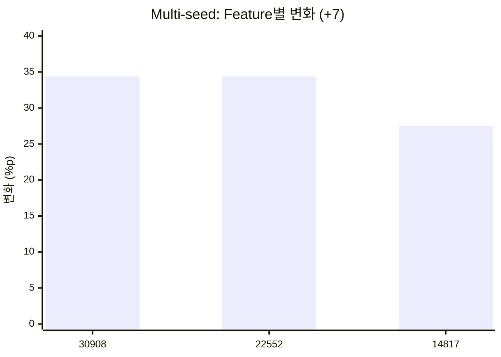
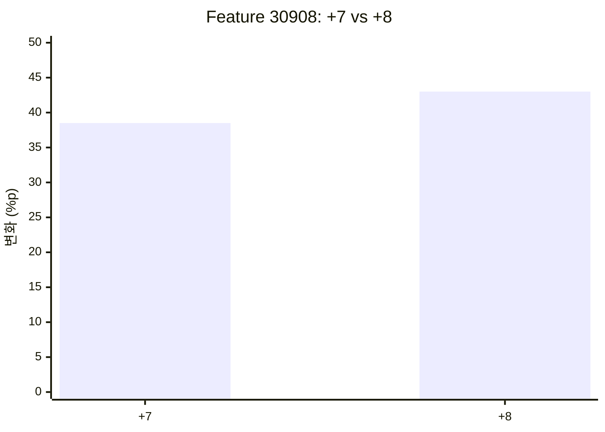

# MindScopeX 주간 연구 진행 현황 (10/11~10/18)

**연구 주제:** Qwen3.5-2B 계열 LLM의 CRT(Cognitive Reflection Test) 직관적 응답 분석 및 SAE Feature 개입 효과 검증  
**연구 기간:** 2026년 10월 11일 ~ 10월 18일

> **모델 설정 검증(2026-10-26):** 본 일지에 과거 기재된 `Qwen3-1.7B-Base`는 확인된 10월 실험 설정과 일치하지 않아 정정했다. `src/mindscopex_analysis/models.py`의 `QWEN35_ANALYSIS_PROFILES["2b"]`는 **행동 모델** `Qwen/Qwen3.5-2B`, **분석 모델** `Qwen/Qwen3.5-2B-Base`, **SAE 저장소** `Qwen/SAE-Res-Qwen3.5-2B-Base-W32K-L0_50`을 정의한다. 확인한 `experiments/configs/study_behavioral_dose_f22552_seed1_cplus2_2b.toml`에는 `model.profile = "2b"`, `feature.layer = 5`, `data.dataset = "hagendorff_crt"`가 지정되어 있다. 다만 해당 문서의 모든 역사적 결과가 어느 모델을 실제 로드했는지는 개별 실행 로그 확인 전까지 확정하지 않는다. 두 모델 ID를 동일한 체크포인트로 혼동하지 않는다. [직전 연구 일지](2026-10-01_2026-10-10.md)도 참고한다.

## 1. 연구 목표

- Qwen3.5-2B 계열의 CRT 직관적 오답(Lure Answer)과 관련된 SAE Feature 분석
- SAE Feature 활성화 조절을 통한 모델 응답 변화 및 인과관계 검증
- Multi-seed 및 Dose-response 실험을 통한 개입 효과의 재현성과 강건성 평가

## 2. 금주 진행 사항

### ① SAE Feature 분석 및 인과 개입 실험

- 확인된 `2b` 프로파일의 Qwen3.5-2B-Base 분석 모델 및 SAE 구성을 기준으로 Layer 5 Residual Stream 기반 Feature 분석 설정 확인 (실제 실행 체크포인트는 각 Run Manifest로 검증 필요)
- 주요 분석 대상 Feature `30908`, `22552`, `14817` 선정
- Feature Ablation 및 Activation Steering을 통한 CRT 응답 변화 분석
- Feature별 개입 효과와 정답률 및 Lure Answer 선택률 비교

### ② Multi-seed 강건성 검증

- 앞선 Top-3 Multi-seed 실험 설계 기준 **Split Seed 0~4(총 5개)** 에서 Feature별 개입 효과를 평가한다. 이는 생성용 시드가 아닌 평가 데이터 구성용 `split_seed`이며, 아래에 기재한 평균 개선 수치가 5개 Seed 전체에서 재계산된 값인지는 원본 Artifact로 확인해야 한다.
- Coefficient `+7`을 **공통 비교 조건**으로 적용했을 때 세 Feature 모두 정답률 개선 기록. **+7이 최적 계수라는 의미는 아니다.**
- Feature별 평균 개선 결과
  - Feature 30908: +34.38%p
  - Feature 22552: +34.38%p
  - Feature 14817: +27.50%p
**그림 1 — 기존 일지의 +7 Feature별 평균 정답률 변화 (%p)**

**그림 2 — 직전 주간 Dose-response: Feature 30908 단독 개입 (%p)**

> **해석:** 그림 1은 이 일지의 +7 고정 Feature 비교이고, 그림 2는 [10/01~10/10 일지](2026-10-01_2026-10-10.md)의 별도 Dose-response 비교다. 그림 2에서 +8은 정답률 82.5%(+43.0%p)로 +7의 78.0%(+38.5%p)보다 높았다. 그러나 그림 1의 30908 +7(+34.38%p)과 그림 2의 +7(+38.5%p)은 집계 범위가 동일한지 확인되지 않아 합산하거나 동일 조건의 결과로 간주하지 않는다. 그림 1의 평균값이 Split Seed 0~4 전체의 집계인지도 원본 Artifact 검증이 필요하다.

- 단일 Seed에만 의존하지 않는지 검토했으나, 중복 평가 Case 여부와 Seed별 분산·통계적 불확실성을 점검해야 재현성 주장을 강화할 수 있다.

### ③ Coefficient Dose-response 실험 확대

- 개입 계수에 따른 CRT 응답 변화 분석
- Fine-grained Dose Sweep **검토 범위:** `-8, -6, -4, -2, 0, +2, +4, +6, +8` (**계획·검토 범위이지 전부 실행 완료를 뜻하지 않음**)
- 기존 실험에서 누락된 `-6`, `+6` 조건 확인: 재실행 및 결과 확보 필요
- Dose 증가에 따른 효과의 비선형성과 Feature별 반응 차이 분석
- 총 120개 실험 조건에 대한 실행 및 결과 수집 상태 점검

### ④ 실험 자동화 및 GitHub 코드 관리

- TOML 기반 실험 Suite 설정 및 Multi-seed 실행 환경 관리
- Google Colab GPU 기반 실험 수행 및 결과 Artifact 보관
- Behavioral Dose/Resume 실험 설정 파일 추가
- GitHub 커밋 `41a9481` 반영
- 실험 결과 ZIP 파일 56개(약 65MB) 보존
- 실험 조건 누락 및 분석 데이터 완전성 점검

### ⑤ 실험 용어 및 검증 지표 정리

| 용어 | 본 일지에서의 의미 |
|---|---|
| **SAE Feature** | Residual Stream 등의 모델 내부 표현을 SAE로 분석했을 때 나타나는 특정 Feature ID. 번호만으로 의미가 확정되지는 않는다 |
| **Activation Steering** | 선택한 Feature 방향으로 모델의 내부 표현에 개입해 응답 변화가 나타나는지 측정 |
| **Ablation** | 해당 Feature의 활성화를 억제·제거하는 방향으로 개입해 응답에 미치는 영향을 확인 |
| **Coefficient** | Steering 개입의 방향(부호)과 세기. `0` 조건의 실제 무개입 동등성은 구현 확인 필요 |
| **Dose-response** | Coefficient를 변경하며 응답 정확도·Lure 선택 비율 등의 변화를 비교 |
| **Multi-seed** | 여러 시드 조건에 동일한 실험을 적용하는 반복 평가. **Split Seed**(평가 문제 구성)와 **Generation Seed**(확률적 생성)는 구분 필요 |
| **Correct / Lure** | 정답과 직관적으로 유혹하는 오답 |
| **Fix Rate** | Baseline에서 Lure였으나 개입 후 Correct가 된 사례의 비율. 반드시 분모 정의를 함께 명시 |
| **Regression Rate** | Baseline Correct에서 개입 후 Lure로 변한 사례의 비율. 반드시 분모 정의를 함께 명시 |
| **Control Specificity** | 목표 문제에 대한 효과와 대조 조건에 대한 영향을 비교하는 검증 관점 |
| **Held-out** | Feature 선택에 사용하지 않은 별도 평가 데이터 또는 조건에서 효과를 확인 |

**CRT 문제 유형**

- **Difference:** 두 대상의 합과 차이를 함께 고려해야 하는 유형
- **Rate:** 병렬 작업률과 처리 시간을 올바르게 계산해야 하는 유형
- **Growth:** 배가·지수적 성장과 선형 성장을 구별해야 하는 유형

### ⑥ 직전 주간 실험과 이번 주간 기록의 연결

[10/01~10/10 실험과정1](2026-10-01_2026-10-10.md)에서는 Feature 후보를 Top-5로 확대하고 Top-3(30908/22552/14817)를 선정한 뒤, Single/Pair/Triple 조합과 개입 강도별 **비선형·비가산적 응답 변화**를 관찰했다. 이번 주에는 해당 Feature를 중심으로 Multi-seed 및 세분화된 Dose 범위의 완전성 검토와 결과 보존·재현성 점검이 이어졌다.

**이번 주에 추가로 확인해야 하는 핵심 사항:** 실험 설정에서 `2b` 프로파일을 확인했지만, 기존 보고 수치만으로는 모든 실행이 동일 모델·평가 데이터·Seed 유형·생성 설정에서 시행되었는지 확정할 수 없다. 따라서 (1) 모델 ID, (2) Split/Generation Seed, (3) 각 Seed의 평가 Case 수와 중복, (4) Baseline/채점 규칙, (5) 완료한 Dose 계수 목록, (6) 누락된 Artifact를 실행 로그로 연결하는 것이 우선이다.

## 3. 주요 연구 성과

- **Feature 인과 개입 효과 확인:** Layer 5의 주요 SAE Feature에 대한 Steering 개입 이후 CRT 정답률 개선 관찰
- **재현성 검증 확대:** 여러 Seed에서 동일한 방향의 개선 효과를 확인하여 단일 실행 결과의 한계 보완
- **Dose-response 특성 분석:** 개입 계수에 따른 응답 변화 및 비선형적 반응 가능성 확인
- **실험 관리 체계 개선:** TOML 기반 실험 설정, GitHub 버전 관리 및 결과 Artifact 보관 체계 강화

## 4. 미완료 사항 및 검증 과제

- 계획된 120개 실험 조건 중 일부 결과 누락 및 분석 대상 부족 확인
- 누락된 Dose 조건 재실행 필요
- Seed별 개입 효과의 통계적 유의성 검증 필요
- Feature 개입 효과가 특정 CRT 유형에 편중되는지 추가 분석 필요
- Strong Null, Control Specificity 및 Held-out 실험 결과를 활용한 인과적 해석 강화 필요

## 5. 향후 연구 계획

1. Multi-seed Dose-response 실험의 누락 조건 보완 및 결과 통합
2. Feature 30908, 22552, 14817의 개입 효과 정량 비교
3. 정답률, Lure Rate, Fix Rate, Regression Rate 기반 세부 분석
4. Feature별 인과 개입 효과의 강건성 및 일반화 가능성 검증
5. 국제학술대회 논문 작성을 위한 실험 결과표 및 시각화 자료 정리

---

## 주간 보고용 핵심 요약

이번 주에는 **Qwen3.5-2B 계열 실험으로 구성된 Layer 5의 SAE Feature 30908, 22552, 14817을 대상으로 인과 개입 및 Multi-seed 강건성 검증을 진행하였습니다.** 앞선 실험 설계에는 Split Seed 0~4(총 5개)가 사용되었으며, Coefficient +7에서 세 Feature의 정답률 개선이 기록되어 있습니다. 기존 일지의 평균 개선 폭 약 27.50~34.38%p가 해당 5개 Seed 전체의 집계인지 여부는 원본 Artifact 재검산이 필요합니다. 또한 Dose-response 실험 범위를 확대하고 TOML 기반 실험 자동화 및 GitHub 결과 관리 체계를 보강하였습니다. 향후 누락된 실험 조건을 보완하고 통계적 검증을 수행하여 논문에 활용할 수 있는 인과적 근거를 강화할 계획입니다.

> **참고:** 10/11~10/18 기간의 기존 연구 기록과 실험 결과 요약을 기준으로 작성했습니다. 위 용어 및 연결 설명은 10/01~10/10 실험과정1의 구조를 참조하여 보완한 것으로, 10/11~10/18의 개별 GPU 실행 로그를 다시 계산한 것은 아닙니다. 수치상 개선은 관찰된 실험 결과이며, 통계적 유의성과 인과적 일반화가 최종 입증되었다는 의미는 아닙니다.

---

## 후속 연구 해석 보완 (2026-10-23 작성) — 선택 문자 CASE 대조의 목적

> **시점 구분:** 아래 내용은 본 일지 기간에 실행한 실험 기록이 아니라, 2026-10-23에 수행·정리한 후속 Pilot 2B·3·4의 설계 이유와 결과를 연결하는 회고적 보완이다. 당시의 실행 결과 및 완료 상태는 위 원문을 따른다. 상세 수치·설정·한계는 [2026-10-23 연구 일지](2026-10-23.md)를 참조한다.

**핵심 연구 질문:** Layer 5 SAE Feature 22552의 개입 후 CRT 정답률이 달라지는 현상이 실제 정답의 의미를 선택한 결과인지, 아니면 출력 문자 또는 선택지 제시 위치에 대한 편향인지 구별할 수 있는가?

| 후속 CASE | 문자 배치 | 실험한 이유 |
|---|---|---|
| Pilot 2B | A/B | 기준 문자 조합에서 계수별 응답 문자 분포와 정답률을 함께 확인하고, B 고정 선택이 정답률을 설명하는지 탐색 |
| Pilot 3 | X/Y | 문자 집합을 바꾸어 A/B 고유의 표면 형식에 의존하는 효과인지 탐색 |
| Pilot 4A | B/A | A/B의 문자 순서를 반전하여 B의 위치가 바뀌었을 때 응답이 어떻게 달라지는지 확인 |
| Pilot 4B | Y/X | X/Y의 문자 순서를 반전하여 X·Y 문자 정체성과 제시 위치의 영향을 추가 점검 |

각 CASE에서 `correct_first`(첫 번째 설정 문자에 정답)와 `lure_first`(두 번째 설정 문자에 정답)를 교차 평가한다. 동일한 CRT 정답값·lure값을 유지하고 문자·배치만 바꾸므로, 특정 문자를 무조건 고르는 모델은 정답 배치에 따라 정확도가 달라질 수 있다. **20개 사례 × 정답 배치 2종 = 40개 평가 조건**은 독립 문항 40개를 뜻하지 않는다.

**후속 관찰:** Pilot 2B에서는 -7 및 +4에서 B 선택 100%·전체 정답률 50%, Pilot 3의 +4에서는 X 선택 87.5%·정답률 57.5%였다. Pilot 4A(B/A)와 4B(Y/X)는 Baseline부터 각각 첫 문자 B·Y를 100% 선택하여 개입 전후 차이를 확인하기 어려웠다(포화). 이 결과만으로 문자 정체성, 위치 또는 CRT 의미 추론 변화 중 어느 요인이 원인인지 확정할 수 없다.

**연구 해석 원칙:** 과거 실험에서 보고된 정답률 개선은 해당 실험 프로토콜의 관찰값으로 보존하되, 의미적 추론 능력 개선의 확정 증거로 해석하지 않는다. 후속 Pilot 5에서는 포화되지 않은 Baseline, 문자·위치 교차 통제, 무개입 계수 0, 다중 seed, 가능하다면 출력 로그잇 및 대조 Feature를 추가 검증한다.
