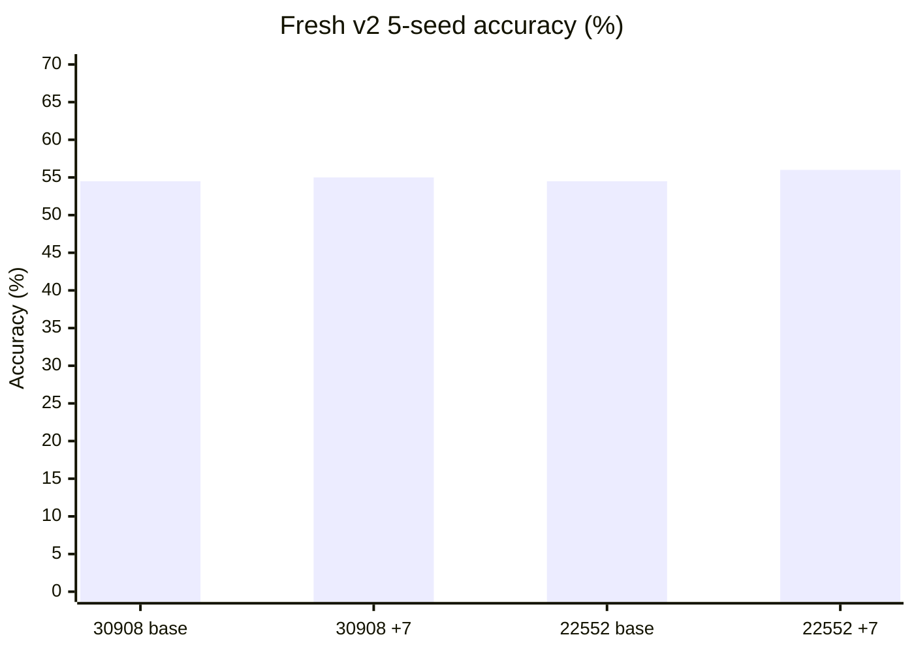
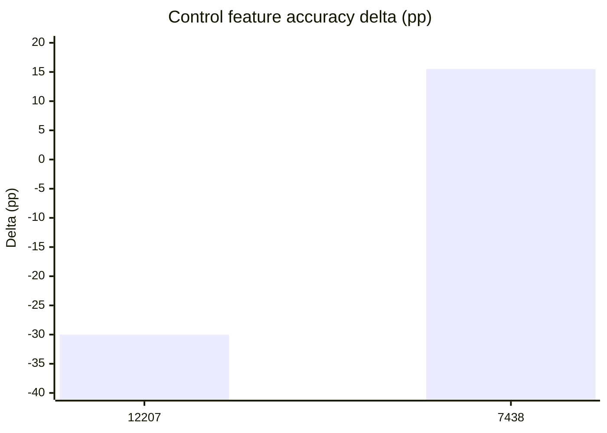
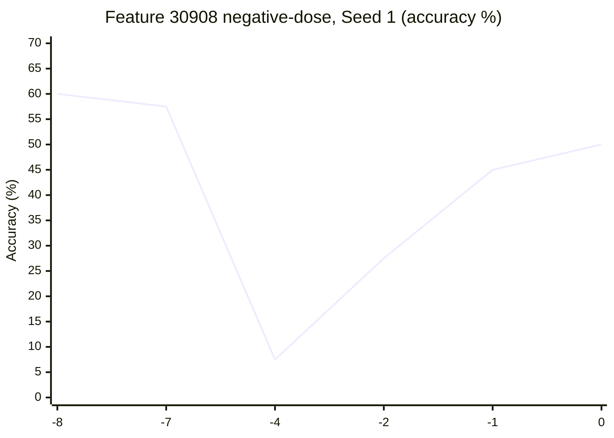

# MindScopeX 상세 연구 실험 일지 — 2026-10-19 ~ 2026-10-21

> **기록 범위:** Fresh v2 전이(Transfer), Multi-seed, 대조 Feature, Negative-dose. 10월 22일 Pilot 2A는 별도 일지에 기록.
>
> **근거 수준:** 이전 연구 대화에서 집계된 수치와 기존 연구 일지를 종합한 재구성 문서. 원본 Colab Artifact 전체를 이 문서 작성 과정에서 다시 계산한 것은 아님. Negative-dose는 Seed 1의 기록된 결과만 상세 수치로 기재함.

## 1. 연구 배경과 핵심 질문

10월 1~18일에는 Qwen 모델의 Layer 5 SAE Feature 30908, 22552, 14817을 중심으로 Single/Pair/Triple, Multi-seed, coefficient dose-response 실험을 수행했다. 기존 데이터에서 Feature 30908, coefficient +8의 정답률은 39.5%에서 82.5%(+43.0%p)로 증가한 것으로 기록되었다.

10월 19~21일에는 다음 질문을 검증했다.

1. 기존 CRT 문항에서 나타난 개선 효과가 **새로운 Fresh v2 문항**으로 전이되는가?
2. 평균 정답률의 변화가 CRT 유형(Difference/Rate/Growth)에 따라 달라지는가?
3. 주요 Feature와 대조 Feature의 효과가 구별되는가?
4. Feature 30908의 음수 coefficient에서 반대 방향 효과 또는 비선형 반응이 나타나는가?

**주의:** 모델 및 출력 형식은 실험별 설정을 따르며, 과거 연구의 Qwen3-1.7B-Base 결과와 이 기간의 Qwen3.5-2B-Base 실험 결과를 동일 조건으로 간주해서는 안 된다. 특히 binary-choice 출력 모드와 자유 생성 모드의 절대 정답률은 직접 비교하지 않는다.

## 2. 10월 19일 — Fresh v2 Transfer 및 Multi-seed 실행

### 2.1 실행 목적·설계

- 대상: Layer 5의 SAE Feature **30908, 22552**
- 개입: coefficient **+7.0**
- 데이터: **`crt_fresh_v2`** 계열의 새로운 CRT 문항
- 실험: Feature별 여러 Seed에 걸친 반복 평가; Seed당 **40개 사례** 설계
- 실행: Google Colab A100, TOML 설정 및 `./experiments/run_colab.sh` 기반 Suite
- 산출물: Colab 실행 로그, 결과 ZIP, `behavioral/generations.json` 등

### 2.2 Seed 1 초기 결과

| Feature | Baseline | Steering +7 | 변화 |
|---|---:|---:|---:|
| 30908 | 20/40 (50.0%) | 20/40 (50.0%) | 0.0%p |
| 22552 | 20/40 (50.0%) | 21/40 (52.5%) | +2.5%p |

Seed 1만으로는 두 Feature 모두 큰 전체 정확도 개선을 보이지 않았다. 다만 유형별 분석에서는 Difference/Growth 개선과 Rate 악화가 동시에 관찰되었다. 초기 분석에서 Rate 악화가 약 −76.9%p로 기록되었으나, 아래 5-seed 유형별 수치와 집계 범위가 다르므로 혼용하지 않는다.

### 2.3 연구적 의미

기존 데이터에서의 강한 Steering 개선이 새로운 데이터로 그대로 이전되지 않았다. 따라서 단순한 평균 정답률 개선보다 **문항 유형별 반응**을 우선 점검할 필요가 생겼다.

## 3. 10월 20일 — 5-seed 통합 및 대조 Feature

### 3.1 Fresh v2 5-seed 통합 정답률

| Feature | Baseline 평균 | Steering +7 평균 | 변화 | 기록된 Seed 간 SD |
|---|---:|---:|---:|---:|
| 30908 | 54.5% | 55.0% | **+0.5%p** | 7.2%p |
| 22552 | 54.5% | 56.0% | **+1.5%p** | 7.4%p |



> 이 그래프는 두 Feature의 Baseline과 Steering 평균을 비교한다. SD 7.2/7.4%p가 정확히 어떤 집계 열의 표준편차인지 원본 통계 코드와 대조하기 전에는 신뢰구간으로 해석하지 않는다.

### 3.2 CRT 유형별 정답률 변화

| 유형 | Feature 30908 | Feature 22552 |
|---|---:|---:|
| Difference | +57.14%p | +47.14%p |
| Rate | **−80.30%p** | **−77.27%p** |
| Growth | +21.88%p | +32.81%p |

```mermaid
xychart-beta
    title "Fresh v2 accuracy delta by CRT family (pp)"
    x-axis ["Difference", "Rate", "Growth"]
    y-axis "Delta (pp)" -100 --> 80
    bar [57.14, -80.30, 21.88]
    bar [47.14, -77.27, 32.81]
```



첫 번째 막대 계열은 Feature 30908, 두 번째 계열은 Feature 22552다. **Difference/Growth에서는 개선, Rate에서는 큰 악화**가 나타났다. 따라서 전체 평균 +0.5~+1.5%p만 보고 Feature 효과가 거의 없다고 단정하는 것도 부정확하다. 정확한 해석은 유형과 출력 조건을 함께 고려해야 한다.

### 3.3 Control Feature 비교

대조 Feature **12207**, **7438**에 대해 추가 실험을 수행했다. Seed 2~5 대상 설정 8개와 실행 Suite를 생성·검증한 기록이 있고, `study_transfer_fresh_v2_control_f7438` 계열의 Colab A100 실행 및 산출물 수집이 기록되어 있다.

| Control Feature | 기록된 평균 정답률 변화 |
|---|---:|
| 12207 | **−30.0%p** |
| 7438 | **+15.5%p** |



**해석:** 대조 Feature에서도 큰 변화가 발생하므로, 단순히 정답률이 변했다는 사실만으로 Feature 30908/22552의 고유한 의미나 CRT 직관 억제 기능을 확정할 수 없다. 같은 데이터, Seed, 출력 형식, 개입 세기에서 대조 조건을 맞춰 비교해야 한다.

## 4. 10월 21일 — Feature 30908 Negative-dose 실험

### 4.1 실험 목적

Fresh v2에서 Rate 유형의 큰 악화가 관찰되었다. 이에 **Steering 방향을 음수로 바꿀 때** 응답이 어떻게 변하는지 확인하기 위해 Feature 30908의 Negative-dose 실험을 수행했다.

- 모델: **Qwen3.5-2B-Base**
- 대상: **Layer 5 / Feature 30908**
- 데이터: Fresh v2, **40개 사례**
- 출력: 제약된 **binary choice** 응답
- 계수: **`0, -1, -2, -4, -7, -8`**
- Git Commit: **`70f4e25`** — `Add fresh CRT negative dose experiment for feature 30908`
- 설정 파일: `experiments/configs/study_transfer_fresh_v2_negative_dose_f30908_seed1_2b.toml`
- Seed 1 정량 결과 확인; 추가 Seed 전체 완료·집계 상태는 별도 검증 필요

### 4.2 Seed 1 정답률

| Coefficient | Correct / 40 | Accuracy | Baseline 대비 | Lure→Correct | Correct→Lure |
|---|---:|---:|---:|---:|---:|
| 0 | 20 | 50.0% | 기준 | — | — |
| −1 | 18 | 45.0% | −5.0%p | 0 | 2 |
| −2 | 11 | 27.5% | −22.5%p | 0 | 9 |
| −4 | 3 | 7.5% | −42.5%p | 1 | 18 |
| −7 | 23 | 57.5% | +7.5%p | 9 | 6 |
| −8 | 24 | 60.0% | +10.0%p | 10 | 6 |



**관찰:** −1→−4에서는 정확도가 50.0%에서 7.5%까지 악화했지만, −7과 −8에서는 57.5%, 60.0%로 다시 상승했다. 개입 효과는 coefficient 크기에 대해 **비단조적(non-monotonic)**이었다.

### 4.3 응답 전이 분석

```mermaid
xychart-beta
    title "Negative-dose response transitions, Seed 1"
    x-axis ["-1", "-2", "-4", "-7", "-8"]
    y-axis "Cases" 0 --> 20
    bar [0, 0, 1, 9, 10]
    bar [2, 9, 18, 6, 6]
```



첫 번째 계열은 **Lure→Correct(Fix)**, 두 번째 계열은 **Correct→Lure(Regression)**이다. −4에서는 회귀 18건이 수정 1건을 압도하지만, −8에서는 수정 10건이 회귀 6건보다 많다. 단, 이 수치는 단일 Seed에서 관찰된 전이이며 기제의 증거는 아니다.

**해석상의 주의:** −8의 정답률이 높다고 해서 음수 Steering이 직관적 오답을 억제한다고 결론 낼 수 없다. 문항별 효과, 선택지 문자 편향, Seed별 재현성, 강한 계수에서의 출력 안정성을 추가 검증해야 한다.

## 5. 기간 전체의 통합 해석

1. **전이성 한계:** 기존 CRT 데이터에서의 큰 개선은 Fresh v2에서 그대로 재현되지 않았다(30908 +0.5%p, 22552 +1.5%p).
2. **유형 의존성:** Difference/Growth와 Rate의 반응 방향이 반대다. 이는 집계 평균을 왜곡하거나 상쇄할 수 있다.
3. **대조군 필요성:** Control Feature 12207·7438에서도 큰 정답률 변화가 기록되었다.
4. **비단조적 Dose-response:** Feature 30908의 음수 계수는 단순한 선형·단조 반응이 아니다(Seed 1).
5. **통계적 제한:** Seed별 반복은 동일·유사 문제를 공유할 수 있으므로 전체 평가 슬롯을 모두 독립 표본으로 간주하지 않는다.
6. **후속 연구 연결:** 질문 순서·선택지 위치·출력 모드에 의한 교란을 분리하는 실험이 필요하며, 이는 10월 22일 Pilot 2A 및 이후 Pilot 2B와 연결된다.

## 6. 코드·Git·산출물 관리

| 구분 | 내용 |
|---|---|
| 저장소 | https://github.com/davidkss/mindscopex_analysis |
| Transfer | `study_transfer_fresh_v2_f30908`, `study_transfer_fresh_v2_f22552` 계열 |
| Controls | `study_transfer_fresh_v2_control_f7438` 및 Feature 12207 계열 |
| Negative-dose | `study_transfer_fresh_v2_negative_dose_f30908_seed1_2b.toml` |
| Commit | `70f4e25` (10/21) |
| 실행 | Colab A100, Colab CLI, TOML Suite |
| 주요 결과 | ZIP 내 `behavioral/generations.json`, 실행 로그 |

실행 방식 예시(실제 Suite 이름은 해당 Commit에서 확인):

```bash
./experiments/run_colab.sh <suite-file.toml> --session <session-name>
```

## 7. 남은 검증 과제

- [ ] Negative-dose의 다른 Seed 실행·완료 여부 및 결과 파일 확인
- [ ] Seed별 전이표와 95% 신뢰구간, paired 비교
- [ ] Difference/Rate/Growth 유형별 원본 JSON 재집계
- [ ] 대조 Feature와 주요 Feature의 완전히 일치하는 조건 비교
- [ ] coefficient 0의 Baseline 일치 여부 검증
- [ ] 선택지 A/B 선호와 정답률 변화 분리
- [ ] 원본 Artifact, 설정 파일, Commit SHA를 결과표와 일대일 연결

## 8. 연구 연속성 메모

**10/19~21 완료:** Fresh v2 Multi-seed 전이 평가, Control Feature 비교, Feature 30908 Negative-dose Seed 1 결과 확보.  
**미확정:** Negative-dose 전체 Seed 통합 결론, 원본 Artifact 재검증 및 통계적 유의성.  
**10/22 연결:** Pilot 2A에서 Feature 22552의 정답 선택지 A/B 위치에 따른 비대칭 효과를 확인했으며, 별도 `2026-10-22.md`에 기록됨.  
**다음:** Pilot 2B에서 coefficient별 문자 선택 편향과 추론 효과를 구분한다.

---

**자료 출처:** 10/19~21 연구 대화·실험 출력의 기록된 집계, 기존 `research/journal/2026-10-19_2026-10-21.md`, `research/journal/2026-10-01_2026-10-10.md`, `research/journal/2026-10-11_2026-10-18.md`. 이 문서의 그래프는 표에 적힌 수치로 생성한 Mermaid 시각화이며 원본 Artifact에서 자동 생성한 그림은 아니다.


---

## 후속 연구 해석 보완 (2026-10-23 작성) — 선택 문자 CASE 대조의 목적

> **시점 구분:** 아래 내용은 본 일지 기간에 실행한 실험 기록이 아니라, 2026-10-23에 수행·정리한 후속 Pilot 2B·3·4의 설계 이유와 결과를 연결하는 회고적 보완이다. 당시의 실행 결과 및 완료 상태는 위 원문을 따른다. 상세 수치·설정·한계는 [2026-10-23 연구 일지](2026-10-23.md)를 참조한다.

**핵심 연구 질문:** Layer 5 SAE Feature 22552의 개입 후 CRT 정답률이 달라지는 현상이 실제 정답의 의미를 선택한 결과인지, 아니면 출력 문자 또는 선택지 제시 위치에 대한 편향인지 구별할 수 있는가?

| 후속 CASE | 문자 배치 | 실험한 이유 |
|---|---|---|
| Pilot 2B | A/B | 기준 문자 조합에서 계수별 응답 문자 분포와 정답률을 함께 확인하고, B 고정 선택이 정답률을 설명하는지 탐색 |
| Pilot 3 | X/Y | 문자 집합을 바꾸어 A/B 고유의 표면 형식에 의존하는 효과인지 탐색 |
| Pilot 4A | B/A | A/B의 문자 순서를 반전하여 B의 위치가 바뀌었을 때 응답이 어떻게 달라지는지 확인 |
| Pilot 4B | Y/X | X/Y의 문자 순서를 반전하여 X·Y 문자 정체성과 제시 위치의 영향을 추가 점검 |

각 CASE에서 `correct_first`(첫 번째 설정 문자에 정답)와 `lure_first`(두 번째 설정 문자에 정답)를 교차 평가한다. 동일한 CRT 정답값·lure값을 유지하고 문자·배치만 바꾸므로, 특정 문자를 무조건 고르는 모델은 정답 배치에 따라 정확도가 달라질 수 있다. **20개 사례 × 정답 배치 2종 = 40개 평가 조건**은 독립 문항 40개를 뜻하지 않는다.

**후속 관찰:** Pilot 2B에서는 -7 및 +4에서 B 선택 100%·전체 정답률 50%, Pilot 3의 +4에서는 X 선택 87.5%·정답률 57.5%였다. Pilot 4A(B/A)와 4B(Y/X)는 Baseline부터 각각 첫 문자 B·Y를 100% 선택하여 개입 전후 차이를 확인하기 어려웠다(포화). 이 결과만으로 문자 정체성, 위치 또는 CRT 의미 추론 변화 중 어느 요인이 원인인지 확정할 수 없다.

**연구 해석 원칙:** 과거 실험에서 보고된 정답률 개선은 해당 실험 프로토콜의 관찰값으로 보존하되, 의미적 추론 능력 개선의 확정 증거로 해석하지 않는다. 후속 Pilot 5에서는 포화되지 않은 Baseline, 문자·위치 교차 통제, 무개입 계수 0, 다중 seed, 가능하다면 출력 로그잇 및 대조 Feature를 추가 검증한다.
