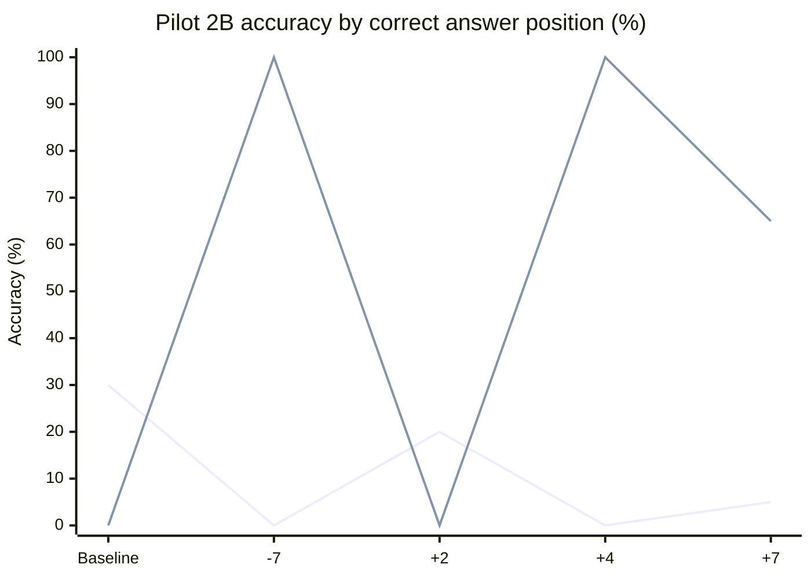
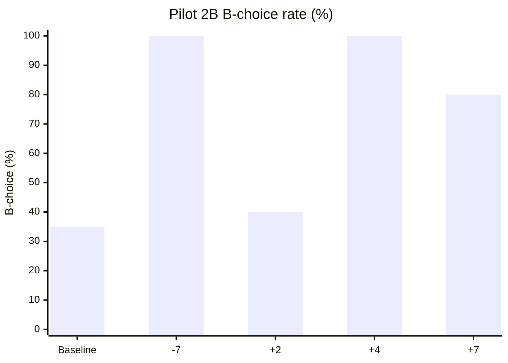

# MindScopeX 연구 실험 일지 — 2026-10-23

## 1. 목적
Pilot 2A에서 관찰한 Feature 22552의 선택지 A/B 위치 의존성이 coefficient 변화에 따라 어떻게 달라지는지 검증한다. 추론 개선과 출력 문자 편향을 구분하기 위한 Pilot 2B이다.

## 2. 실험 환경 및 실행 이력
- 모델: `Qwen/Qwen3.5-2B-Base`
- SAE: Layer 5, Feature 22552
- 데이터: `crt_fresh_v2_rate_order_pilot`, 기초 문제 10개 × 질문 순서 2종 × 선택지 순서 2종 = 평가 조건 40개
- 출력: `binary_choice_letter`; `token_position=all`
- 계수: `[-7.0, 2.0, 4.0, 7.0]`; Baseline 별도 비교
- 설정: `experiments/configs/study_rate_choice_order_dose_f22552_seed1_2b.toml`
- Suite: `experiments/suites/study_rate_choice_order_dose_f22552_2b.toml`
- Commit: `84acce5` — `Add Pilot 2B choice-order coefficient dose suite` (GitHub main push 성공)
- 실행: `./experiments/run_colab.sh experiments/suites/study_rate_choice_order_dose_f22552_2b.toml --session mindscopex-rate-choice-dose`
- 환경: Colab A100; 실행 및 다운로드 후 세션 종료
- 결과: `results/runs/20261023-094451_study_rate_choice_order_dose_f22552_seed1_2b/artifacts.zip`
- ZIP 내 핵심 원본: `behavioral/generations.json` (244,342 bytes)
- 검증: JSON 결과 8개 블록, 각 블록 baseline/steered 20개; 동일 선택지 순서 내 coefficient별 baseline 동일. 사용자 제공 실행 출력에 기반.

## 3. 검증된 결과

### 3.1 선택지 정답 위치별 정확도

| Coefficient | 정답 A (20조건) | 정답 B (20조건) | 전체 (40조건) | Baseline 대비 |
|---|---:|---:|---:|---:|
| Baseline | 6/20 (30%) | 0/20 (0%) | 6/40 (15%) | — |
| -7 | 0/20 (0%) | 20/20 (100%) | 20/40 (50%) | +35%p |
| +2 | 4/20 (20%) | 0/20 (0%) | 4/40 (10%) | -5%p |
| +4 | 0/20 (0%) | 20/20 (100%) | 20/40 (50%) | +35%p |
| +7 | 1/20 (5%) | 13/20 (65%) | 14/40 (35%) | +20%p |

첫 번째 선: 정답 A, 두 번째 선: 정답 B.

### 3.2 실제 응답 문자 분포

| Coefficient | 정답 A 배치 시 A/B | 정답 B 배치 시 A/B | 전체 A/B | B 선택률 |
|---|---:|---:|---:|---:|
| Baseline | 6/14 | 20/0 | 26/14 | 35% |
| -7 | 0/20 | 0/20 | 0/40 | 100% |
| +2 | 4/16 | 20/0 | 24/16 | 40% |
| +4 | 0/20 | 0/20 | 0/40 | 100% |
| +7 | 1/19 | 7/13 | 8/32 | 80% |

### 3.3 응답 전이 (정답/오답)

Baseline 정답 6건은 정답 A 배치에만 존재한다. 사용자 제공 원본 검증 출력에 따르면 -7, +4에서 정답 A 조건은 모두 오답, 정답 B 조건은 모두 정답이다. +2에서는 전체 정답 4건, +7에서는 전체 정답 14건이다. 정확한 문항별 Fix/Regression 교차표는 원본 JSON의 `case_id`를 결합해 추가 산출할 필요가 있다.

## 4. 해석

**관찰 사실:** -7과 +4에서는 40/40이 B 응답이며, 전체 정답률은 50%이다. 정답이 B에 배치된 조건에서만 정답률 100%가 나타난다. +7에서도 B 응답 비율은 80%이다. +2에서는 B 응답 비율 40%로 Baseline 35%에 가깝다.

**가설:** Feature 22552 개입은 CRT 추론 개선보다 출력 문자 B에 대한 선호 또는 생성 경로의 변화를 유도할 수 있다. 서로 반대 부호의 -7과 +4에서 같은 B 고정 현상이 나타나므로 부호 반전만으로 메커니즘을 설명하기 어렵다. 이 결과는 Feature의 의미론적 기능이나 인과 메커니즘을 단독으로 확정하지 않는다.

**한계:** 기초 문제는 10개이며 40개 조건은 독립 문항 40개가 아니다. 단일 실행/seed의 결과이며 여러 coefficient에서 출력 포화 현상이 나타날 수 있다. 제약된 문자 응답은 자유 생성 CRT 추론 능력과 동일하지 않다. 원본 ZIP은 사용자 로컬에 있고 이 일지의 집계는 사용자 제공 ZIP 검증 출력과 실행 로그에 근거한다.

## 5. Pilot 2A 비교

Pilot 2A의 coefficient +7은 전체 6/40→14/40, 정답 A 6/20→1/20, 정답 B 0/20→13/20으로 기록되어 있다. Pilot 2B의 +7 조건도 동일한 집계값이다. 다만 두 실행의 원본 행별 동일성은 별도 비교가 필요하다.

## 6. 후속 실험 권고

1. 원본 JSON에서 문항별 `baseline_rows`/`steered_rows`를 매칭해 Fix/Regression 및 B 선택 전이표를 추출한다.
2. 계수 0을 명시적 무개입 대조로 추가하고 -7/+4의 B 고정 현상을 다중 seed로 반복한다.
3. B 응답 포화가 발생하는 임계 구간을 탐색하고 출력 로그잇/확률을 가능하면 함께 기록한다.
4. 대조 Feature, 중립 문제, 다른 선택지 레이블(X/Y 등)을 사용해 B 문자 자체에 대한 편향인지 분리한다.
5. 기초 문제 단위로 묶어 paired 통계와 신뢰구간을 평가한다.

## 7. 실행 상태

- 완료: TOML/Suite 작성, CPU mock 검증, 기존 Pilot 2A 회귀 테스트 4개 통과, Commit/Push, Colab A100 실험, ZIP 다운로드, 8개 블록 JSON 구조·정답률·A/B 분포 확인.
- 미완료: 다중 seed, 추가 대조, 문항별 전이표, 통계적 유의성, 메커니즘 검증.

---

## Pilot 3 — X/Y 선택 문자 대조 실험

아래 결과는 사용자가 제공한 Pilot 3 실행 결과를 기록한 것이다. 이 구현 작업에서는 GPU 실험을 재실행하거나 원본 결과 파일을 재검증하지 않았다.

### 실험 조건

- Model: Qwen/Qwen3.5-2B-Base
- Layer: 5
- SAE Feature: 22552
- Dataset: crt_fresh_v2_rate_order_pilot
- Split seed: 1
- Token position: all
- Output mode: binary_choice_letter
- Choice letters: ["X", "Y"]
- Choice orders: ["correct_first", "lure_first"]
- Coefficients: [-7.0, 4.0, 7.0]
- Git commit: 2c3de8f
- 각 choice order의 사례 수: 20 (동일 사례를 두 순서로 평가)

### 결과

Correct first와 Lure first는 각 순서에서의 정답 수이며, Accuracy와 X rate는 두 순서를 합친 40개 응답 기준이다.

| Coefficient | Correct first | Lure first | Accuracy | X rate |
| ----------- | ------------- | ---------- | -------- | ------ |
| Baseline    | 0/20          | 20/20      | 50%      | 0%     |
| -7          | 16/20         | 5/20       | 52.5%    | 77.5%  |
| +4          | 19/20         | 4/20       | 57.5%    | 87.5%  |
| +7          | 19/20         | 1/20       | 50%      | 95%    |

### 해석 및 후속 대조

Baseline은 두 순서 모두 Y를 출력하는 패턴과 일치한다. Steering에서는 X 응답 비율이 77.5–95%로 증가하며, correct_first의 높은 정답률과 lure_first의 낮은 정답률이 동반된다. 따라서 한 순서에서 관찰되는 정답률 상승을 CRT 추론 능력 개선으로 직접 해석해서는 안 된다. 출력 문자 편향과 전체 정답률 변화를 구분해야 한다.

+4의 합산 정답률은 57.5%이지만, 동일한 20개 사례를 순서만 바꾸어 반복한 소규모 평가이며 문자/위치 선호와 독립적인 추론 개선이 입증된 것은 아니다. +7에서는 X rate가 95%인 동시에 합산 정답률이 baseline과 같은 50%다. 이 결과는 출력 선택 편향의 영향을 시사하지만 SAE Feature 22552의 인과적 메커니즘은 아직 확정되지 않았다. 특히 현재 X/Y 배치만으로는 X 문자 자체의 선호와 첫 번째 선택지 위치의 선호를 분리할 수 없다.

후속 Pilot 4A는 ["B", "A"], Pilot 4B는 ["Y", "X"]를 사용한다. Pilot 2B(A/B), Pilot 3(X/Y)와 비교하여 문자 정체성 선호와 제시 위치 선호를 구분한다. correct_first는 첫 번째 설정 문자에 정답을, lure_first는 두 번째 설정 문자에 정답을 배치한다. 나머지 Pilot 3 조건과 coefficients [-7.0, 4.0, 7.0]은 유지한다. Pilot 4 설정 및 CPU 테스트만 추가하며 GPU 실험 결과는 아직 없다.
