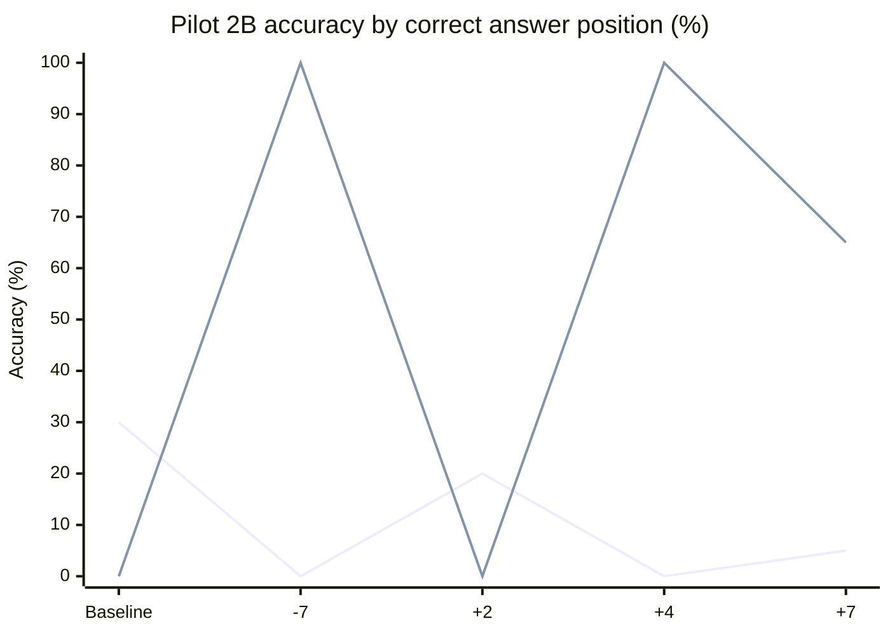
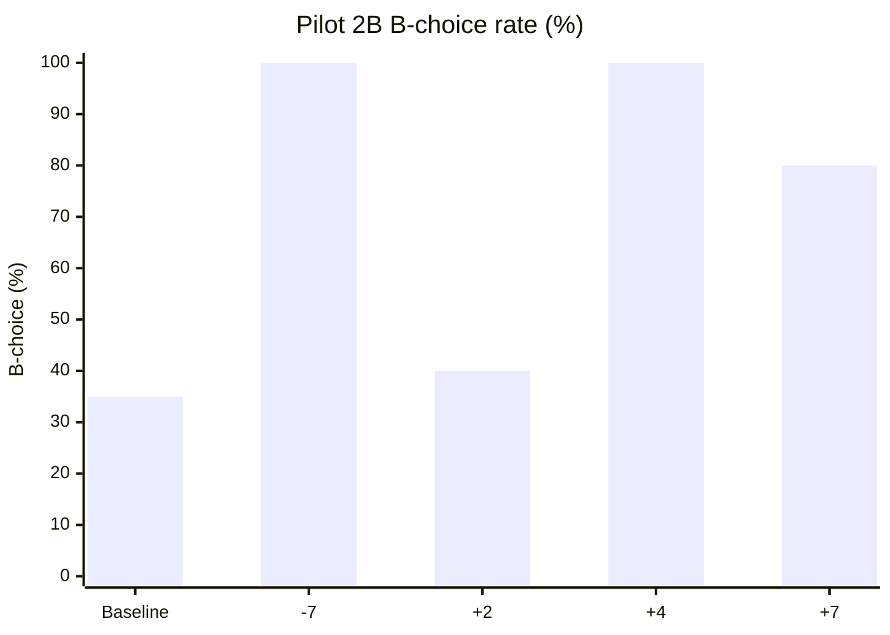

# MindScopeX 연구 실험 일지 — 2026-10-23

## 1. 목적
Pilot 2A에서 관찰한 Feature 22552의 선택지 A/B 위치 의존성이 coefficient 변화에 따라 어떻게 달라지는지 검증한다. 추론 개선과 출력 문자 편향을 구분하기 위한 Pilot 2B이다.

## 2. 실험 환경 및 실행 이력
- 모델: `Qwen/Qwen3.5-2B-Base`
- SAE: Layer 5, Feature 22552
- 데이터: `crt_fresh_v2_rate_order_pilot`, 기초 문제 10개 × 질문 순서 2종 × 선택지 순서 2종 = 평가 조건 40개
- 출력: `binary_choice_letter`; `token_position=all`
- 계수: `[-7.0, 2.0, 4.0, 7.0]`; Baseline 별도 비교
- 설정: `experiments/configs/study_rate_choice_order_dose_f22552_seed1_2b.toml`
- Suite: `experiments/suites/study_rate_choice_order_dose_f22552_2b.toml`
- Commit: `84acce5` — `Add Pilot 2B choice-order coefficient dose suite` (GitHub main push 성공)
- 실행: `./experiments/run_colab.sh experiments/suites/study_rate_choice_order_dose_f22552_2b.toml --session mindscopex-rate-choice-dose`
- 환경: Colab A100; 실행 및 다운로드 후 세션 종료
- 결과: `results/runs/20261023-094451_study_rate_choice_order_dose_f22552_seed1_2b/artifacts.zip`
- ZIP 내 핵심 원본: `behavioral/generations.json` (244,342 bytes)
- 검증: JSON 결과 8개 블록, 각 블록 baseline/steered 20개; 동일 선택지 순서 내 coefficient별 baseline 동일. 사용자 제공 실행 출력에 기반.

## 3. 검증된 결과

### 3.1 선택지 정답 위치별 정확도

| Coefficient | 정답 A (20조건) | 정답 B (20조건) | 전체 (40조건) | Baseline 대비 |
|---|---:|---:|---:|---:|
| Baseline | 6/20 (30%) | 0/20 (0%) | 6/40 (15%) | — |
| -7 | 0/20 (0%) | 20/20 (100%) | 20/40 (50%) | +35%p |
| +2 | 4/20 (20%) | 0/20 (0%) | 4/40 (10%) | -5%p |
| +4 | 0/20 (0%) | 20/20 (100%) | 20/40 (50%) | +35%p |
| +7 | 1/20 (5%) | 13/20 (65%) | 14/40 (35%) | +20%p |

첫 번째 선: 정답 A, 두 번째 선: 정답 B.

### 3.2 실제 응답 문자 분포

| Coefficient | 정답 A 배치 시 A/B | 정답 B 배치 시 A/B | 전체 A/B | B 선택률 |
|---|---:|---:|---:|---:|
| Baseline | 6/14 | 20/0 | 26/14 | 35% |
| -7 | 0/20 | 0/20 | 0/40 | 100% |
| +2 | 4/16 | 20/0 | 24/16 | 40% |
| +4 | 0/20 | 0/20 | 0/40 | 100% |
| +7 | 1/19 | 7/13 | 8/32 | 80% |

### 3.3 응답 전이 (정답/오답)

Baseline 정답 6건은 정답 A 배치에만 존재한다. 사용자 제공 원본 검증 출력에 따르면 -7, +4에서 정답 A 조건은 모두 오답, 정답 B 조건은 모두 정답이다. +2에서는 전체 정답 4건, +7에서는 전체 정답 14건이다. 정확한 문항별 Fix/Regression 교차표는 원본 JSON의 `case_id`를 결합해 추가 산출할 필요가 있다.

## 4. 해석

**관찰 사실:** -7과 +4에서는 40/40이 B 응답이며, 전체 정답률은 50%이다. 정답이 B에 배치된 조건에서만 정답률 100%가 나타난다. +7에서도 B 응답 비율은 80%이다. +2에서는 B 응답 비율 40%로 Baseline 35%에 가깝다.

**가설:** Feature 22552 개입은 CRT 추론 개선보다 출력 문자 B에 대한 선호 또는 생성 경로의 변화를 유도할 수 있다. 서로 반대 부호의 -7과 +4에서 같은 B 고정 현상이 나타나므로 부호 반전만으로 메커니즘을 설명하기 어렵다. 이 결과는 Feature의 의미론적 기능이나 인과 메커니즘을 단독으로 확정하지 않는다.

**한계:** 기초 문제는 10개이며 40개 조건은 독립 문항 40개가 아니다. 단일 실행/seed의 결과이며 여러 coefficient에서 출력 포화 현상이 나타날 수 있다. 제약된 문자 응답은 자유 생성 CRT 추론 능력과 동일하지 않다. 원본 ZIP은 사용자 로컬에 있고 이 일지의 집계는 사용자 제공 ZIP 검증 출력과 실행 로그에 근거한다.

## 5. Pilot 2A 비교

Pilot 2A의 coefficient +7은 전체 6/40→14/40, 정답 A 6/20→1/20, 정답 B 0/20→13/20으로 기록되어 있다. Pilot 2B의 +7 조건도 동일한 집계값이다. 다만 두 실행의 원본 행별 동일성은 별도 비교가 필요하다.

## 6. 후속 실험 권고

1. 원본 JSON에서 문항별 `baseline_rows`/`steered_rows`를 매칭해 Fix/Regression 및 B 선택 전이표를 추출한다.
2. 계수 0을 명시적 무개입 대조로 추가하고 -7/+4의 B 고정 현상을 다중 seed로 반복한다.
3. B 응답 포화가 발생하는 임계 구간을 탐색하고 출력 로그잇/확률을 가능하면 함께 기록한다.
4. 대조 Feature, 중립 문제, 다른 선택지 레이블(X/Y 등)을 사용해 B 문자 자체에 대한 편향인지 분리한다.
5. 기초 문제 단위로 묶어 paired 통계와 신뢰구간을 평가한다.

## 7. 실행 상태

- 완료: TOML/Suite 작성, CPU mock 검증, 기존 Pilot 2A 회귀 테스트 4개 통과, Commit/Push, Colab A100 실험, ZIP 다운로드, 8개 블록 JSON 구조·정답률·A/B 분포 확인.
- 미완료: 다중 seed, 추가 대조, 문항별 전이표, 통계적 유의성, 메커니즘 검증.

---

## Pilot 3 — X/Y 선택 문자 대조 실험

아래 결과는 사용자가 제공한 Pilot 3 실행 결과를 기록한 것이다. 이 구현 작업에서는 GPU 실험을 재실행하거나 원본 결과 파일을 재검증하지 않았다.

### 실험 조건

- Model: Qwen/Qwen3.5-2B-Base
- Layer: 5
- SAE Feature: 22552
- Dataset: crt_fresh_v2_rate_order_pilot
- Split seed: 1
- Token position: all
- Output mode: binary_choice_letter
- Choice letters: ["X", "Y"]
- Choice orders: ["correct_first", "lure_first"]
- Coefficients: [-7.0, 4.0, 7.0]
- Git commit: 2c3de8f
- 각 choice order의 사례 수: 20 (동일 사례를 두 순서로 평가)

### 결과

Correct first와 Lure first는 각 순서에서의 정답 수이며, Accuracy와 X rate는 두 순서를 합친 40개 응답 기준이다.

| Coefficient | Correct first | Lure first | Accuracy | X rate |
| ----------- | ------------- | ---------- | -------- | ------ |
| Baseline    | 0/20          | 20/20      | 50%      | 0%     |
| -7          | 16/20         | 5/20       | 52.5%    | 77.5%  |
| +4          | 19/20         | 4/20       | 57.5%    | 87.5%  |
| +7          | 19/20         | 1/20       | 50%      | 95%    |

### 해석 및 후속 대조

Baseline은 두 순서 모두 Y를 출력하는 패턴과 일치한다. Steering에서는 X 응답 비율이 77.5–95%로 증가하며, correct_first의 높은 정답률과 lure_first의 낮은 정답률이 동반된다. 따라서 한 순서에서 관찰되는 정답률 상승을 CRT 추론 능력 개선으로 직접 해석해서는 안 된다. 출력 문자 편향과 전체 정답률 변화를 구분해야 한다.

+4의 합산 정답률은 57.5%이지만, 동일한 20개 사례를 순서만 바꾸어 반복한 소규모 평가이며 문자/위치 선호와 독립적인 추론 개선이 입증된 것은 아니다. +7에서는 X rate가 95%인 동시에 합산 정답률이 baseline과 같은 50%다. 이 결과는 출력 선택 편향의 영향을 시사하지만 SAE Feature 22552의 인과적 메커니즘은 아직 확정되지 않았다. 특히 현재 X/Y 배치만으로는 X 문자 자체의 선호와 첫 번째 선택지 위치의 선호를 분리할 수 없다.

후속 Pilot 4A는 ["B", "A"], Pilot 4B는 ["Y", "X"]를 사용한다. Pilot 2B(A/B), Pilot 3(X/Y)와 비교하여 문자 정체성 선호와 제시 위치 선호를 구분한다. correct_first는 첫 번째 설정 문자에 정답을, lure_first는 두 번째 설정 문자에 정답을 배치한다. 나머지 Pilot 3 조건과 coefficients [-7.0, 4.0, 7.0]은 유지한다. Pilot 4 설정 및 CPU 테스트 작성 당시에는 GPU 결과가 없었으며, 이후 실행·집계 결과는 아래 Pilot 4 항목에 기록한다.

---

## Pilot 4 — 선택 문자 순서 반전 대조 (2026-10-23)

### 목적 및 설정

Pilot 2B의 A/B, Pilot 3의 X/Y 배치를 반전하여 문자 정체성 효과와 첫 번째/두 번째 선택지 위치 효과를 점검한다. Qwen/Qwen3.5-2B-Base, Layer 5, SAE Feature 22552, token_position=all, binary_choice_letter, seed 1, 계수 [-7, +4, +7]을 사용한다. 각 Pilot은 10개 기초 문제의 문장 순서 2종 × 정답 선택지 배치 2종으로 구성된 40개 평가 조건이다. 동일 조건이 coefficient마다 반복되므로 독립 표본으로 간주하지 않는다.

- Pilot 4A: choice_letters=[B,A], config `experiments/configs/study_rate_choice_ba_pilot_f22552_seed1_2b.toml`
- Pilot 4B: choice_letters=[Y,X], config `experiments/configs/study_rate_choice_yx_pilot_f22552_seed1_2b.toml`
- Suite: `experiments/suites/study_rate_choice_reversal_pilot_f22552_2b.toml`
- 설정 및 연구 일지 최초 커밋: `272165c`
- 실행: `./experiments/run_colab.sh experiments/suites/study_rate_choice_reversal_pilot_f22552_2b.toml --session mindscopex-rate-choice-reversal`
- 환경: Colab A100, 두 작업 정상 실행·결과 ZIP 다운로드 후 세션 종료
- Pilot 4A 결과: `results/runs/20261023-101522_study_rate_choice_ba_pilot_f22552_seed1_2b/artifacts.zip`
- Pilot 4B 결과: `results/runs/20261023-101715_study_rate_choice_yx_pilot_f22552_seed1_2b/artifacts.zip`
- 각 ZIP에 `behavioral/generations.json`(183,745 bytes), `manifest.json`, `job.log` 포함. 사용자 제공 터미널 출력으로 검증.

### 계수별 집계

각 JSON은 6개 블록(3개 계수 × 2개 정답 배치), 블록별 baseline_rows 20개와 steered_rows 20개다. 아래 비율은 계수별 40개 조건을 합산한 값이다. Baseline은 계수마다 동일 조건으로 재기록된 것이므로 서로 독립적인 반복 측정이 아니다.

| Pilot | Coefficient | Baseline correct | Steered correct | Baseline first-letter | Steered first-letter |
|---|---:|---:|---:|---:|---:|
| 4A B/A | -7 | 20/40 (50%) | 20/40 (50%) | B 40/40 (100%) | B 40/40 (100%) |
| 4A B/A | +4 | 20/40 (50%) | 20/40 (50%) | B 40/40 (100%) | B 40/40 (100%) |
| 4A B/A | +7 | 20/40 (50%) | 20/40 (50%) | B 40/40 (100%) | B 40/40 (100%) |
| 4B Y/X | -7 | 20/40 (50%) | 20/40 (50%) | Y 40/40 (100%) | Y 40/40 (100%) |
| 4B Y/X | +4 | 20/40 (50%) | 20/40 (50%) | Y 40/40 (100%) | Y 40/40 (100%) |
| 4B Y/X | +7 | 20/40 (50%) | 20/40 (50%) | Y 40/40 (100%) | Y 40/40 (100%) |

모든 조건에서 lure는 20/40 (50%)다. 첫 번째 문자가 정답인 20조건에서는 정답, 두 번째 문자가 정답인 20조건에서는 lure를 고른 결과와 일치한다.

### Pilot 2B·3·4 비교: 실제 선택 문자

| Pilot | 문자 순서 | Baseline | Steering -7 | Steering +4 | Steering +7 |
|---|---|---|---|---|---|
| 2B | A/B | B 35% | B 100% | B 100% | B 80% |
| 3 | X/Y | X 0% | X 77.5% | X 87.5% | X 95% |
| 4A | B/A | B 100% | B 100% | B 100% | B 100% |
| 4B | Y/X | Y 100% | Y 100% | Y 100% | Y 100% |

### 해석 및 한계

**관찰:** 반전된 두 조건에서는 baseline부터 첫 번째 설정 문자를 100% 출력하며, 개입 계수 -7/+4/+7에서도 응답 문자와 정답률이 바뀌지 않았다. 따라서 이 두 조건에서는 Feature 22552 개입의 추가적인 행동 효과를 관찰하지 못했다. Baseline이 이미 100%이므로 첫 문자 선택률의 천장 효과가 존재한다.

**비교:** Pilot 2B의 +4에서는 두 번째 문자 B를 100% 선택했고, Pilot 3의 +4에서는 첫 번째 문자 X를 87.5% 선택했다. 따라서 네 Pilot 전체를 단일한 '첫 번째 위치 선호' 또는 '특정 문자 선호'만으로 설명할 수 없다. 선택지 문자 집합, 제시 순서, 프롬프트와 개입의 상호작용 가능성을 추가 검증해야 한다.

**결론의 범위:** 본 결과는 제한된 이진 문자 출력에서의 행동 변화 또는 무변화를 보여준다. CRT 의미 추론 능력의 개선이나 Feature 22552의 의미론적 역할·인과 메커니즘을 입증하지 않는다. 단일 seed, 기초 문제 10개, 재사용된 평가 조건, 포화된 baseline이 한계다. 이 기록의 집계는 사용자 제공 ZIP 검사·집계 출력에 근거하며 원본 JSON을 이 편집 과정에서 별도로 재계산하지 않았다.

### 후속 조치

1. Baseline이 포화되지 않는 문자·프롬프트 조합을 선별해 Pilot 5를 설계한다.
2. 정답 위치와 문자 정체성을 교차시킨 대조 및 다중 seed를 추가한다.
3. 가능하면 응답 문자 로그잇/확률과 사례별 baseline→steering 전이를 기록한다.
4. 대조 SAE Feature 및 무개입 계수 0을 포함하고 의미적 정답 개선 여부를 분리 검증한다.

---

## Pilot 2B·3·4 CASE 설계의 이유 — 선택 문자 및 위치 대조

### 연구 질문

SAE Layer 5 Feature 22552를 개입했을 때 관찰되는 CRT 정답률 변화가 **문제의 의미를 이해하고 정답을 선택한 결과**인지, 아니면 **출력 문자(A/B/X/Y) 및 선택지 위치에 대한 선호** 때문인지 구분한다. 같은 정답값과 lure값을 유지하고 선택지의 문자 표기 및 배치를 변경하여, 표면 형식에 의존하는 행동 변화를 확인하는 통제 실험이다.

### 네 가지 CASE를 선택한 이유

| CASE | 선택 문자 순서 | 선택 이유 | 주로 비교할 CASE |
|---|---|---|---|
| Pilot 2B | A/B | 최초 기준 문자 조합에서 계수 변화에 따른 정답률과 실제 선택 문자 분포를 확인한다. B 고정 응답이 정답률에 미치는 영향을 식별한다. | 기준 조건 |
| Pilot 3 | X/Y | A/B 이외의 문자로 변경해 효과가 특정 A/B 문자 집합에만 의존하는지 탐색한다. | Pilot 2B |
| Pilot 4A | B/A | A/B 문자 집합은 유지하되 문자 순서를 반전한다. B가 두 번째에서 첫 번째로 이동했을 때 선택 경향이 유지되는지 살펴본다. | Pilot 2B |
| Pilot 4B | Y/X | X/Y 문자 집합은 유지하되 문자 순서를 반전한다. X가 첫 번째에서 두 번째로 이동했을 때 선택 경향이 유지되는지 살펴본다. | Pilot 3 |

위 네 CASE는 **문자 집합 변경(A/B ↔ X/Y)** 및 **집합 내 순서 반전(A/B ↔ B/A, X/Y ↔ Y/X)**을 통해 응답이 표면 형식에 민감한지 검증하려는 목적을 가진다. 이 설계만으로 문자 정체성과 위치의 독립적인 인과 효과가 완전히 식별되는 것은 아니다.

### CASE 내부의 정답 위치 교차 통제

각 CASE는 `choice_orders = ["correct_first", "lure_first"]`를 사용한다.

- `correct_first`: 첫 번째 설정 문자에 CRT 정답값, 두 번째 문자에 직관적 오답(lure)을 배치한다.
- `lure_first`: 첫 번째 설정 문자에 lure, 두 번째 문자에 정답값을 배치한다.

예를 들어 실제 데이터의 특정 문항이 아닌 **설명용 가상 정답값**을 정답 `3분`, lure `20분`으로 놓으면, A/B·correct_first는 `A: 3분 / B: 20분`, A/B·lure_first는 `A: 20분 / B: 3분`이다. B/A에서는 각각 `B: 3분 / A: 20분`, `B: 20분 / A: 3분`으로 바뀐다. X/Y와 Y/X도 같은 방식이다. 문자와 위치가 달라져도 의미상 정답값은 바뀌지 않는다.

각 Pilot의 **20개 사례를 두 정답 배치로 평가한 40개 조건**은 독립적인 40개 문항이 아니다. 또한 여러 계수에서 같은 사례와 배치를 반복 평가하므로 독립 표본으로 합산하지 않는다.

### 관찰 결과와 설계 목적의 연결

- **Pilot 2B(A/B)**: -7과 +4에서 B 40/40, 전체 정답률 20/40. B가 정답인 배치에서만 정답이므로, 정답률 50% 자체가 추론 개선의 증거는 아니다.
- **Pilot 3(X/Y)**: +4에서 X 87.5%, 정답률 57.5%. A/B 이외 문자에서도 선택 문자 쏠림이 관찰되지만, 단일 원인으로 단정할 수 없다.
- **Pilot 4A(B/A)**: Baseline부터 B 100%, 개입 후에도 B 100%. 반전 조건에서 개입의 추가 효과를 측정하기 어려운 포화 상태다.
- **Pilot 4B(Y/X)**: Baseline부터 Y 100%, 개입 후에도 Y 100%. Pilot 3의 X 쏠림을 단순한 고정 문자 선호로 설명할 수 없음을 보여준다.

**핵심 해석:** 네 CASE는 Feature 22552 개입의 행동 효과를 CRT 의미 추론 개선과 혼동하지 않도록 설계된 통제 조건이다. 결과는 문자·순서·프롬프트·개입 사이의 상호작용 가능성을 보여주지만, 특정 문자 또는 첫 번째 위치만이 원인이라고 확정하지 못한다. 정답률과 함께 **실제 출력 문자, 정답 배치별 정확도, Baseline 대비 개입 전이**를 함께 보고해야 한다.

### Pilot 5에 반영할 설계 원칙

1. Baseline이 특정 문자에 100% 포화되지 않는 조건을 먼저 탐색한다.
2. 동일 문항에서 문자 집합, 문자 순서, 정답 위치를 교차하여 비교한다.
3. 계수 0 대조, 다중 seed, 사례별 대응 분석을 사용한다.
4. 가능하면 선택 문자 로그잇/확률 및 대조 Feature를 추가해 출력 편향과 의미적 정답 선택의 차이를 검증한다.

이 절은 기존 Pilot 2B·3·4 결과를 바탕으로 **각 CASE를 실험한 이유**를 명시적으로 보강한 것이다. 추가 GPU 실험이나 새로운 결과를 뜻하지 않는다.

## 연구 방향 확정 (2026-10-23) — Feature 우선순위 및 Pilot 해석

> **현재 연구 운영 결정:** Layer 5 **Feature 30908을 주 연구 대상(primary feature)** 으로 유지하고, **Feature 22552를 비교 대상(comparison feature)** 으로 지정한다. 이 결정은 기존 결과를 삭제하거나 22552 실험을 무효화하지 않으며, 향후 실험 설계와 논문 서술의 우선순위를 명확히 하기 위한 것이다.

### 결정 근거

1. 기존 CRT에서 Feature 30908의 coefficient +8 조건은 Baseline 39.5% → 82.5%(+43.0%p)로 기록되었다. 이는 **해당 평가 조건에서 관찰된 개선**이며, 추론 능력 개선의 인과적 증거로 확정하지 않는다.
2. Fresh v2의 5-seed 결과는 Feature 30908 +0.5%p, Feature 22552 +1.5%p로, 기존 CRT의 큰 효과가 새로운 문제에서 재현되지 않았다. Difference/Growth 개선과 Rate 악화가 공존했다.
3. Feature 22552는 9월 말 Discovery 및 10월 초 Multi-seed에서 유력 후보였으며, Rate Pilot 1 → Pilot 2A~5A에서 사용되었다. **Pilot 1에서 30908 대신 22552를 최초 선택한 이유는 현재 연구 기록에서 확인되지 않았다.** 따라서 22552가 30908보다 우수하여 전환했다는 설명을 사용하지 않는다.
4. Pilot 2A~5A에서 확인한 선택 문자·정답 위치 편향 가능성은 22552 비교 결과로 보존하며, 30908에도 동일한 통제 평가가 필요한지 판단하는 근거로 활용한다.

### 이후 연구 범위 및 종료 기준

- **주 분석:** Feature 30908의 기존 CRT 대비 Fresh v2 전이성, CRT 유형별 효과, 계수별 변화 및 출력 편향 통제.
- **비교 분석:** Feature 22552에 동일한 데이터셋·출력 형식·Seed·계수·평가 규칙을 적용한 대조. 기존 22552 Pilot 결과는 보조 분석으로 유지.
- **추가 실험 원칙:** 새로운 Pilot 번호나 Feature를 무기한 늘리지 않는다. 먼저 기존 Artifact·설정·평가 방식과 Hagendorff CRT 데이터 출처를 확인하고, 사전 정의된 최소한의 일치 조건 비교만 수행한다.
- **실험 종료:** 비교 조건의 결과와 통계적 불확실성, 문자·위치 편향의 영향 및 재현성 한계를 정리한 후 긍정적 개선 여부와 무관하게 논문 작성으로 전환한다.
- **해석 제한:** SAE Feature 30908이 CRT 직관적 오류를 담당한다는 주장은 현재 입증되지 않았다.

### 연구 질문(현 시점)

**SAE Feature 30908 개입으로 관찰된 CRT 정답률 변화는 새로운 문항에서 재현되는가? 그리고 그 변화는 실제 정답 선택의 개선인가, 아니면 출력 문자 및 선택지 배치에 의한 교란인가?** Feature 22552는 동일 조건 비교 대상으로 사용한다.

## 후속 연구 실행 계획 확정 (2026-10-23) — Feature 30908 우선, 신규 Pilot 보류

### 현재 이해·검토가 완료된 범위

- Qwen Layer 5의 **Feature 30908**을 주 연구 대상으로 유지한다.
- 기존 CRT에서 Feature 30908은 Baseline 39.5% → coefficient +8 조건 82.5%(+43.0%p)의 개선이 기록되었다.
- 새로운 **Fresh v2**에서는 Baseline 54.5% → coefficient +7 조건 55.0%(+0.5%p)로 큰 개선이 재현되지 않았다.
- **주의:** 두 결과는 coefficient(+8/+7), 문항 및 평가 설정이 같다고 검증되지 않았으므로, 곧바로 동일 조건의 전이성 비교로 단정하지 않는다.
- 22552의 Pilot 1~5A와 Negative-dose 등 후속 기록은 보존하되, 현재 연구 설명 및 분석은 30908의 기존 CRT와 Fresh v2 결과 차이에 집중한다. 연구 일지에 기록된 모든 후속 실험을 연구자가 이미 이해·승인한 단계로 간주하지 않는다.

### 당면 연구 질문

> **Feature 30908은 왜 기존 CRT에서 큰 정답률 개선을 보였지만, Fresh v2에서는 전체 정답률 개선이 거의 없었는가?**

### 단계별 실행 순서와 완료 조건

| 단계 | 수행 작업 | 완료 조건 | 신규 실험 여부 |
|---|---|---|---|
| 1. Fresh v2 유형별 분석 | Difference / Rate / Growth의 문항과 Baseline→Steering 실제 응답을 확인하고, 정답→오답·오답→정답 전이를 분석한다. 특히 Rate 악화 원인을 조사한다. | 유형별 사례·전이표·해석 한계 문서화 | 없음 |
| 2. 기존 CRT와 Fresh v2 조건 대조 | 문항 출처·구성, coefficient, seed, 프롬프트, 출력 형식, 채점 규칙 및 결과 Artifact를 대조한다. | 조건 차이 목록과 비교 가능 범위 확정 | 없음 |
| 3. Feature 30908 최소 최종 검증 | 1~2단계에서 확인한 교란 요인만 통제하고, 사전 정의한 동일 조건으로 30908의 효과를 재검증한다. | 실험 조건·Seed·지표·종료 기준을 **실행 전** 고정하고 결과 정리 | 필요할 때만 |
| 4. Feature 22552 비교 및 논문 정리 | 22552는 30908과 동일 조건의 비교 대상으로만 사용하고, 기존 Pilot 결과는 출력 편향 보조 분석으로 보존한다. | 재현성·유형별 효과·문자/위치 편향·한계를 포함한 논문 초안 | 원칙적으로 종료 |

### 현재 확인된 Fresh v2 유형별 변화(연구 일지 집계)

| 유형 | Feature 30908 정답률 변화 |
|---|---:|
| Difference | +57.14%p |
| Rate | **−80.30%p** |
| Growth | +21.88%p |

이 값은 **유형별 기록값**이며, 실제 문항별 응답과 집계 분모를 대조하기 전에는 메커니즘에 대한 인과적 결론으로 사용하지 않는다. 전체 평균 +0.5%p와 유형별 변화가 어떻게 연결되는지도 원본 Artifact로 확인한다.

### 연구 운영 및 종료 원칙

1. **지금은 새로운 Pilot을 시작하지 않는다.** 먼저 30908의 Fresh v2 유형별 실제 응답과 기존 CRT 조건 차이를 검토한다.
2. 각 단계는 **실험 목적 → 코드·설정 → 실제 결과 → 해석 → 완료 여부** 순서로 정리한다.
3. 1~2단계 검토 후 필요한 경우에만 **최소한의 30908 통제 실험**을 사전 등록된 조건으로 수행한다. 성능 개선이 작거나 음수여도 결과를 받아들인다.
4. 22552는 **비교 대상**으로 유지한다. 근거 없이 30908을 대체하거나 추가 Feature를 계속 확대하지 않는다.
5. 30908의 효과·불확실성·출력 편향·전이성 한계를 문서화하면 실험을 종료하고 논문 작성으로 전환한다.

**다음 실제 작업:** `research/journal/2026-10-19_2026-10-21.md`의 Feature 30908 Fresh v2 결과를 원본 실행 설정과 `generations.json`에 대조하여 Difference/Rate/Growth별 실제 응답 전이와 Rate 악화의 원인을 분석한다. 이는 향후 작업 계획이며, 원인 규명이 이미 완료되었다는 뜻은 아니다.

## Feature 30908 Fresh v2 +8 검증 준비 (2026-10-23)

- **목적:** 기존 CRT의 +8과 Fresh v2의 +7을 직접 비교할 때 발생한 coefficient 교란 요인을 분리한다. 기존 Fresh v2 +7과 같은 조건에서 **+8만 변경**한다.
- **주 대상:** Layer 5 / Feature 30908. Feature 22552는 이번 실험에 포함하지 않는다.
- **기존 +7 기준:** Fresh v2 5-seed, Baseline 109/200(54.5%), Steering 110/200(55.0%), +0.5%p. 유형별 Difference +57.14%p, Rate −80.30%p, Growth +21.88%p.
- **신규 설정:** `experiments/configs/study_transfer_fresh_v2_f30908_cplus8_seed{1..5}_2b.toml` (5개 파일). 원본 `study_transfer_fresh_v2_f30908_seed{1..5}_2b.toml`에서 run.name과 `behavioral.coefficients=[8.0]`만 변경하고 나머지 설정 유지.
- **Suite:** `experiments/suites/study_transfer_fresh_v2_f30908_cplus8_5seed_2b.toml`.
- **실행 예시:** `./experiments/run_colab.sh experiments/suites/study_transfer_fresh_v2_f30908_cplus8_5seed_2b.toml --session fresh-v2-f30908-cplus8` (실행 전 CLI 인자 및 GPU 연결 상태 확인).
- **사전 분석 지표:** Seed별 Baseline/Steering 정확도, 전체 paired 전이(Lure→Correct, Correct→Lure), Difference/Rate/Growth 유형별 전이, +7과 +8 동일 Seed·문항의 paired 비교. 기존 원본 `generations.json`을 재사용해 비교한다.
- **종료 기준:** 5개 Seed가 정상 완료되고 원본 Artifact 검증을 마치면 결과가 긍정적이든 부정적이든 이번 coefficient 검증을 종료한다. 신규 Feature/Pilot은 추가하지 않는다.
- **상태:** GitHub에 설정·Suite **생성 완료**, Colab GPU **미실행**, +8 결과 **미확인**. 기존 CRT와 Fresh v2의 데이터셋 차이는 여전히 별개의 변수다.

## Feature 30908 Fresh v2 +8 결과 및 응답 구조 검증 (2026-10-23)

- 사용자 제공 Colab CLI 실행 로그: +8, Seed 1~5 각 40개, 모델 Qwen3.5-2B-Base, artifact ZIP 5개 다운로드 및 세션 정상 종료 확인. 결과 ZIP 내부의 원본 `generations.json`은 아직 별도 재검증하지 않았으며 로그의 case별 correct/lure를 기준으로 계산.
- **5-seed pooled +8:** baseline 109/200 (54.5%), steering 97/200 (48.5%), **-6.0%p**. Seed별 baseline→steering: 1=20→19, 2=25→21, 3=19→21, 4=25→17, 5=20→19.
- **유형별 +8:** Difference 21/70→61/70 (+57.14%p), Growth 34/64→34/64 (0.00%p), Rate 54/66→2/66 (-78.79%p).
- **기존 +7 대비:** Difference 61/70로 동일, Growth 48/64→34/64 (-14건), Rate 1/66→2/66 (+1건), 전체 110/200→97/200 (-13건). +8로 맞춰도 Hagendorff CRT +8의 +43%p 개선은 Fresh v2에서 재현되지 않음.
- **출력 코드 확인:** `src/mindscopex_analysis/generation.py`의 `generate_constrained_choice_response`는 `candidates=[correct_answer,lure_answer]`를 만들고 `_constrained_answer_ids`가 prefix-allowed-token greedy decode(`do_sample=False`)를 수행한다. **A/B 문자 선택 실험이 아니며**, 후보의 순서가 텍스트 선택지로 노출되는 구조도 아니다. 정답/오답의 문자열 및 토큰 효과는 여전히 분석 대상.
- **Fresh v2 전체 150문항의 정답 숫자 방향:** Difference 50/50 correct < lure, Growth 50/50 correct > lure, Rate 50/50 correct < lure. Difference와 Rate 모두 정답이 더 작지만 steering 효과가 정반대이므로 단순한 '작은 숫자 선호' 가설은 단독 설명으로 부족.
- **해석 한계:** 200개는 seed별 40개 평가 슬롯의 합으로 독립 문항 200개가 아님. +7과 +8의 결과 차이는 기술통계이며, 인과적 feature 의미·추론 능력 향상을 증명하지 않음. 구체적인 Rate 실패 기제는 미규명.
- **후속:** 새 GPU 실험은 보류. 동일 case_id에 대한 +7/+8 원본 generations.json 대조, 답안의 토큰화·문장 템플릿별 응답 패턴 분석. 본 coefficient 5-seed 검증은 종료.

## Fresh v2 +7 원본 generations.json 기반 템플릿별 전이 분석 (2026-10-23)

- **근거:** GitHub에 커밋된 `results/runs/20261019-{155728,162901,163038,163135,163232}_study_transfer_fresh_v2_f30908_seed{1..5}_2b/artifacts/behavioral/generations.json`의 `baseline_rows`, `steered_rows`를 `case_id`로 매칭하고, `src/mindscopex_analysis/data/crt_fresh_v2.json`의 `template_id`를 결합. 모두 **Coefficient +7** 결과. +8의 원본 generations.json은 현재 GitHub tree에서 발견되지 않아 템플릿별 직접 비교 미실시.
- **Rate 템플릿별 (n / baseline correct / +7 correct / correct→lure):** wording_1 17/14/0/14, wording_2 12/10/0/10, wording_3 15/13/0/13, wording_4 9/4/1/3, wording_5 13/13/0/13. 전체 66/54/1/53. 다섯 템플릿 모두 정답 감소.
- **Difference 템플릿별:** wording_1 18/6/15, wording_2 19/6/15, wording_3 13/1/12, wording_4 8/1/7, wording_5 12/7/12. 다섯 템플릿 모두 개선.
- **Growth 템플릿별:** wording_1 11/7/4, wording_2 20/11/17, wording_3 15/5/12, wording_4 12/7/12, wording_5 6/4/3. 문장 템플릿에 따라 개선·악화 혼재.
- **Rate 사례:** `crt_fresh_v2_rate_002` (4 minutes correct → 23 minutes lure), `crt_fresh_v2_rate_013` (3 minutes correct → 56 minutes lure), `crt_fresh_v2_rate_016` (6 minutes correct → 65 minutes lure), 모두 Seed 1에서 관찰.
- **잠정 해석:** Rate 악화가 한 문장 템플릿에 국한되지는 않는다. 그러나 5-seed 슬롯은 독립 사례가 아니며, 템플릿별 표본 수가 작고, 개입이 실제로 어떤 내부 계산을 바꿨는지는 미확인. 특히 +8 템플릿별 paired 결과는 원본 artifact 확보 전까지 주장하지 않는다.
- **다음:** +8의 원본 `generations.json` GitHub 업로드/경로 확인 후 동일 case_id의 +7/+8 응답 차이를 계산. 추가 GPU 실험 불필요.
